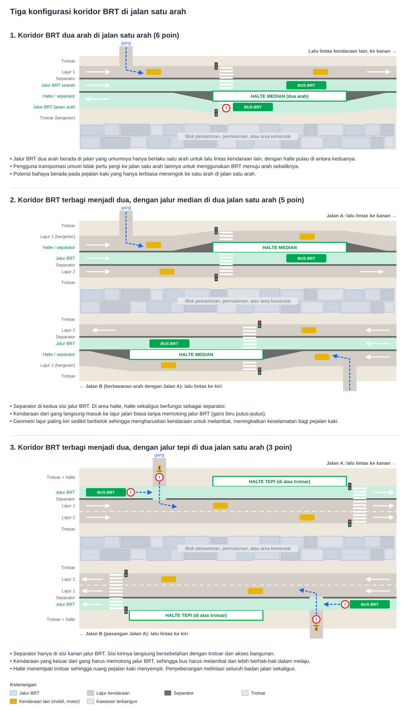

# Mengapa Sebagian Halte BRT Berada di Tengah Jalan?

Kawasan Metropolitan Cekungan Bandung akan segera memiliki layanan *bus rapid transit* (BRT). Melalui proyek MASTRAN (*Indonesia Mass Transit Project*), pemerintah membangun koridor BRT sepanjang 21,7 km dengan 38 halte *on-corridor*. Jaringan rutenya akan menjangkau lima daerah: Kota Bandung, Kota Cimahi, Kabupaten Bandung, Kabupaten Bandung Barat, dan Kabupaten Sumedang. Bank Dunia (*World Bank*) dan Agence Française de Développement (AFD), lembaga pembangunan milik Pemerintah Prancis, membiayai konstruksi dan pengembangan proyek ini melalui pinjaman, sementara layanannya nanti akan beroperasi dengan nama Metro Jabar Trans (MJT) dengan pendanaan dari pemerintah daerah.

Kini, pembangunan halte mulai terlihat di sejumlah ruas jalan. Bagi sebagian warga yang melintas, bangunan setengah jadi di tengah jalan dianggap janggal. Bagaimana bisa sebuah halte berdiri di antara lajur kendaraan, jauh dari trotoar, seolah menjadi pulau kecil di tengah arus lalu lintas? Wajar jika muncul pertanyaan. Bagaimana penumpang mencapainya? Bus mana yang akan berhenti di sana? Mengapa halte tidak berada di pinggir jalan seperti biasanya?

Jika berdiri sendiri, halte seperti ini memang tidak masuk akal. Namun perlu diketahui, halte median yang dibangun saat ini bukanlah halte bus biasa. Halte ini merupakan satu kesatuan dari sistem BRT. Sistem tersebut mencakup jalur khusus yang memisahkan bus dari kendaraan lain, separator fisik di sepanjang jalur, penyeberangan bagi pejalan kaki, pengaturan lampu lalu lintas di persimpangan, lantai halte setinggi lantai bus, serta perbaikan aksesibilitas lainnya. Ketika semua komponen ini bekerja bersama, halte di median jalan justru menjadi salah satu kunci kecepatan BRT.

## Apa itu BRT?

ITDP (*Institute for Transportation and Development Policy*), organisasi nirlaba yang bergerak di bidang transportasi sejak 1985, menyusun acuan internasional untuk merancang dan menilai koridor BRT yang disebut sebagai *BRT Standard*. Dalam edisi 2024, ITDP mendefinisikan BRT sebagai sistem angkutan cepat berbasis bus dengan kapasitas tinggi yang memberikan layanan cepat, berkualitas, andal, aman, dan hemat biaya.

Ketika membahas posisi halte dan jalur khusus di median jalan, kata kunci yang harus digarisbawahi adalah huruf "R" dalam "BRT", yakni *rapid* atau cepat. Kemacetan dan antrean kendaraan yang berhenti atau berbelok di depan bus menyita banyak waktu perjalanan bus kota biasa. BRT harus mampu mengejar kecepatan dengan menghilangkan sumber-sumber hambatan tersebut.

*BRT Standard* menyebut lima elemen dasar (*BRT Basics*) yang membedakan BRT dari layanan bus biasa:

1. **Jalur khusus** (*dedicated right-of-way*). Bus melaju di jalurnya sendiri, terpisah dari kendaraan lain, idealnya dengan separator fisik.
2. **Letak jalur** (*busway alignment*). Jalur bus menempati bagian jalan dengan gangguan paling sedikit, umumnya di tengah jalan.
3. **Pembayaran di luar bus** (*off-board fare collection*). Penumpang membayar di halte sebelum naik, sehingga bus tidak perlu menunggu penumpang membayar.
4. **Penanganan persimpangan** (*intersection treatments*). Pengaturan lalu lintas di persimpangan mendahulukan bus, misalnya dengan melarang kendaraan lain berbelok memotong jalur BRT.
5. **Peron setinggi lantai bus** (*platform-level boarding*). Penumpang, termasuk pengguna kursi roda, dapat naik dan turun tanpa menaiki anak tangga.

ITDP juga menetapkan syarat minimum. Setiap elemen dasar bernilai maksimal 7 poin, sehingga totalnya 35 poin. Sebuah koridor baru memenuhi definisi BRT jika memenuhi empat syarat, yakni memiliki jalur khusus sepanjang minimal 3 km (beserta kriteria pendukung lainnya), meraih minimal 4 poin pada elemen **jalur khusus**, meraih minimal 4 poin pada elemen **letak jalur**, dan meraih total minimal 20 poin dari kelima elemen dasar. Nilai tinggi pada elemen lain tidak bisa menutupi kekurangan pada dua elemen ini. Dengan kata lain, keberadaan jalur khusus saja belum cukup. Letak jalur tersebut di badan jalan ikut menentukan seberapa cepat, andal, dan aman sebuah layanan BRT. Elemen letak jalur inilah yang menjadi salah satu alasan sebagian halte BRT Cekungan Bandung berada di median jalan.

## Dua posisi halte

Segmen *on-corridor* BRT Cekungan Bandung menunjukkan dua posisi halte. Sebagian besar halte menempati **tepi jalan** (28 halte), sementara sepuluh halte lainnya berdiri di **median jalan**. Halte median ini berupa "pulau" yang berada di antara lajur kendaraan biasa dan jalur BRT. Mengapa tidak semua halte berada di tepi jalan, yang tampak lebih dekat bagi penumpang?

Jawabannya kembali ke prinsip *rapid* tadi, **bus harus bisa melaju tanpa gangguan kendaraan lain**. Untuk memahaminya, kita perlu melihat cara ITDP menilai letak jalur. *BRT Standard* edisi 2024 memberi poin untuk setiap konfigurasi jalur. ITDP lalu menghitung nilai akhir koridor BRT berdasarkan persentase panjang koridor yang memakai tiap konfigurasi.

| Konfigurasi jalur BRT | Poin |
|---|---|
| Jalur dua arah di median jalan dua arah | 7 |
| Koridor khusus bus tanpa lalu lintas kendaraan lain (misalnya *transit mall*) | 7 |
| Jalur di sisi jalan yang bersebelahan dengan taman, sungai, atau kawasan lain dengan sedikit persimpangan | 7 |
| Jalur dua arah di satu sisi jalan satu arah | 6 |
| Pasangan jalan satu arah, jalur BRT di tengah badan jalan | 5 |
| Jalur di tepi luar jalur utama pada jalan yang memiliki jalur lambat | 4 |
| Jalur di tepi dalam jalur lambat, dengan separator fisik | 3 |
| Pasangan jalan satu arah, jalur BRT di tepi jalan | 3 |
| Jalur virtual dua arah dalam satu lajur median | 1 |
| Jalur di tepi jalan dua arah | 0 |

Polanya cukup jelas. Secara umum, semakin jauh jalur BRT dari aktivitas di tepi jalan, semakin tinggi nilainya. Jalur dan halte di tepi jalan dua arah tidak mendapat poin sama sekali. ITDP melakukan ini untuk mendorong konfigurasi letak jalur dan halte bus yang mampu mengurangi risiko keterlambatan akibat konflik dengan kendaraan yang berbelok dan aktivitas di tepi jalan.

### Letak jalur juga memengaruhi elemen lain

Pengaruh letak jalur tidak berhenti pada elemen *busway alignment*. Beberapa elemen lain dalam *BRT Standard* juga bergantung pada letak jalur dan halte:

- **Halte tengah** (*center stations*, maksimal 2 poin). ITDP memberi poin untuk halte yang berada di tengah jalan. Nilai tertinggi diberikan untuk halte tunggal yang melayani dua arah sekaligus, karena halte seperti ini memudahkan penumpang berpindah arah dan menghemat ruang. Namun, ITDP juga mengakui halte tengah yang hanya melayani satu arah, termasuk halte yang terbagi menjadi dua bangunan terpisah untuk masing-masing arah (*split stations*). Koridor meraih 1 poin jika lebih dari 80 persen haltenya berada di tengah jalan, meskipun hanya melayani satu arah. Halte median BRT Cekungan Bandung termasuk jenis ini: setiap halte berada di tengah badan jalan dan melayani satu arah. Sebaliknya, halte tepi jalan tidak mendapat poin pada elemen ini.
- **Profil permintaan** (*demand profile*, maksimal 3 poin). ITDP merekomendasikan ruas dengan permintaan penumpang tertinggi memiliki jalur khusus dengan konfigurasi letak jalur terbaik. Nilainya mengikuti tingkatan konfigurasi pada tabel di atas, yakni 3 poin untuk konfigurasi tingkat 1 (misalnya jalur dua arah di median), 2 poin untuk tingkat 2 (misalnya koridor berpasangan di jalan satu arah), dan 1 poin untuk tingkat 3.
- **Akses dan keselamatan pejalan kaki** (*pedestrian access and safety*, maksimal 4 poin). Salah satu syaratnya adalah pejalan kaki maksimal menyeberangi dua lajur sebelum mencapai tempat berlindung yang terlindungi secara fisik, seperti trotoar atau median. Halte median dapat berfungsi sebagai tempat berlindung tersebut. Bagian keselamatan di bawah membahas hal ini lebih lanjut.
- **Pengurangan nilai operasional.** *BRT Standard* juga mengurangi nilai koridor yang sudah beroperasi jika kendaraan lain sering menyerobot jalur BRT (hingga -7 poin), jika kecepatan komersial bus di bawah 20 km/jam (hingga -10 poin), dan jika terjadi kematian pejalan kaki atau pesepeda di sepanjang koridor (hingga -2 poin). Letak jalur yang baik membantu koridor menghindari ketiga pengurangan ini.

### Kasus Bandung: kota dengan banyak jalan satu arah

Pusat Kota Bandung memiliki jaringan jalan satu arah yang padat. Kajian Analisis Dampak Lalu Lintas proyek MASTRAN mencatat 29 ruas jalan yang akan menampung jalur khusus BRT. Dari jumlah itu, **22 ruas merupakan jalan satu arah**, dan hanya tujuh ruas yang melayani dua arah. Jalan Ahmad Yani di Cicadas misalnya, terbagi menjadi dua ruas terpisah untuk masing-masing arah. Jalan Asia Afrika, Jalan Jenderal Sudirman, Jalan Rajawali Barat, Jalan Rajawali Timur, Jalan Kebon Jati, dan Jalan Otto Iskandardinata juga merupakan jalan satu arah.

Kondisi ini membatasi pilihan konfigurasi. Pada jalan satu arah, konsultan perencana hanya memiliki tiga pilihan utama:

1. **Jalur dua arah di satu sisi jalan satu arah (6 poin).** Salah satu arah bus melaju melawan arus kendaraan lain. Meskipun memiliki nilai yang tinggi, *BRT Planning Guide* (panduan perencanaan BRT dari ITDP) mencatat potensi bahaya karena pejalan kaki tidak terbiasa menoleh ke arah lawan arus saat menyeberang di jalan satu arah. Kajian Duduta dkk. (2012) terhadap sembilan sistem BRT pun menempatkan jalur lawan arus sebagai konfigurasi paling berbahaya.
2. **Sepasang jalan satu arah dengan jalur BRT di median jalan (5 poin).** Bus melaju searah arus kendaraan lain di jalur yang tidak bersebelahan dengan trotoar.
3. **Sepasang jalan satu arah dengan jalur BRT di tepi jalan (3 poin).** Bus melaju searah arus lalu lintas di lajur paling kiri yang bersebelahan dengan trotoar.

*Gambar: tampak atas ketiga konfigurasi dengan ruang milik jalan yang sama. Pada konfigurasi 1, kedua jalur BRT menempati sisi kanan jalan satu arah dengan halte pulau di antaranya, sehingga kendaraan pribadi tinggal memiliki satu lajur, dan jalur BRT lawan arah berada tepat di tepi trotoar. Pada konfigurasi 2, separator dan halte pulau memisahkan jalur BRT dari lajur kendaraan di kedua sisinya, sehingga kendaraan dari gang tidak perlu memotong jalur BRT. Pada konfigurasi 3, jalur BRT bersebelahan langsung dengan trotoar dan akses bangunan, sehingga muncul titik konflik. Ilustrasi berskala, tetapi ukuran lajur dan halte bersifat indikatif, bukan gambar DED.*

*BRT Planning Guide* menganggap konfigurasi sepasang jalan satu arah (opsi 2 dan 3) memiliki kelebihan, yakni mengurangi dampak terhadap lalu lintas kendaraan lain, parkir, dan bongkar muat. Rute koridor BRT dengan konfigurasi seperti ini juga bisa jadi mengikuti rute bus yang sudah ada. Namun kekurangannya, penumpang berpotensi kebingungan karena halte untuk arah pergi dan arah pulang berada di jalan yang berbeda.

#### Bukan konfigurasi baru

Jalur BRT di tengah jalan satu arah bukan eksperimen yang dilakukan pertama kalinya di Bandung. Beberapa sistem BRT di dunia memakai konfigurasi ini, terutama di pusat kota yang padat dan memiliki banyak jalan satu arah:

- **Guayaquil, Ekuador (Metrovía).** *BRT Planning Guide* menyebut Guayaquil berhasil memakai konfigurasi di median jalan untuk koridor di pusat kota.
- **Johannesburg, Afrika Selatan (Rea Vaya).** Di luar pusat kota, Rea Vaya memakai jalur dua arah di median. Saat memasuki pusat kota, koridor BRT terpisah ke dua jalan satu arah. Letak jalur dan halte tetap berada di median jalan satu arah. *BRT Standard* 2024 memakai Rea Vaya sebagai contoh konfigurasi bernilai 5 poin.

#### Di mana saja halte median BRT Cekungan Bandung?

BRT Cekungan Bandung memakai pilihan kedua dan ketiga: jalur dan halte di median pada sebagian ruas, serta di tepi jalan pada ruas lainnya. Data halte *on-corridor* mencatat sepuluh halte median berikut:

| Kode | Nama halte | Ruas jalan |
|---|---|---|
| BS1 | Stasiun Hall | Jl. Kebon Jati |
| BS2 | Pasar Baru | Jl. Otto Iskandardinata |
| BS13A | Pasar Kosambi (arah timur) | Jl. Ahmad Yani |
| BS14B | Stadion Sidolig (arah barat) | Jl. Ahmad Yani |
| BS15B | IBCC | Jl. Ahmad Yani |
| BS16 | Cicadas | Jl. Ahmad Yani |
| BS29 | Rajawali Timur | Jl. Rajawali Timur |
| BS30 | Ciroyom | Jl. Rajawali Timur |
| BS31 | Trinitas | Jl. Kebon Jati |
| BS32 | RS Kebon Jati | Jl. Kebon Jati |

Halte median terkumpul di empat ruas: Jl. Kebon Jati, Jl. Rajawali Timur, Jl. Ahmad Yani, dan Jl. Otto Iskandardinata.

## Masalah utama jalur dan halte di tepi jalan

Lajur paling kiri di jalanan perkotaan hampir selalu menjadi lajur tersibuk. Angkot berhenti untuk mengambil penumpang, ojek menunggu pesanan, mobil parkir, kendaraan menurunkan barang, dan kendaraan lain keluar-masuk toko, gang, atau SPBU. Jika jalur BRT menempati lajur kiri, bus harus berbagi ruang dengan semua aktivitas tersebut, meskipun jalurnya sudah memiliki marka atau separator.

Akibatnya:

- **Kendaraan lain mudah menghalangi jalur.** Satu kendaraan yang berhenti sudah cukup untuk menutup seluruh jalur bus.
- **Setiap akses menimbulkan konflik.** Gang, halaman, dan tempat putar balik memaksa kendaraan lain memotong jalur BRT.
- **Kapasitasnya terbatas.** *BRT Planning Guide* mencatat bahwa jalur tepi sulit melayani lebih dari 5.000 penumpang per jam per arah jika kendaraan yang berbelok sering mengganggu jalur bus.

## Keuntungan jalur dan halte di tengah jalan

Memindahkan jalur BRT ke tengah jalan menghilangkan sebagian besar gangguan tersebut. Keuntungannya mencakup beberapa aspek yang saling berkaitan.

### Kecepatan dan keandalan

*BRT Standard* mencatat bahwa jalur di median menghadapi lebih sedikit konflik dengan kendaraan yang berbelok, karena median berada jauh dari gang, area parkir, dan aktivitas bongkar muat. Taksi dan kendaraan pengantar barang membutuhkan akses ke tepi jalan, sedangkan bagian tengah jalan umumnya bebas dari hambatan semacam itu. Bus dapat menjaga kecepatan dan ketepatan waktu.

### Keselamatan

Kajian Duduta dkk. (2012) yang sama juga menemukan bahwa sistem dengan jalur di tengah jalan umumnya lebih aman daripada sistem dengan jalur di tepi jalan. Laporan World Resources Institute (WRI) tahun 2015 juga mencatat bahwa keberadaan median di tengah jalan berkaitan dengan penurunan kecelakaan fatal dan kecelakaan dengan korban luka sebesar 35 persen. Bagian berikutnya membahas keselamatan halte median secara lebih rinci, termasuk kekhawatiran yang sering muncul di masyarakat.

### Satu bangunan, tiga fungsi

Pada jalan satu arah seperti di Bandung, halte median melayani satu arah perjalanan. Meski begitu, halte pulau ini tetap efisien karena satu bangunan menjalankan tiga fungsi sekaligus:

1. **Peron penumpang**, tempat penumpang menunggu dan naik-turun bus.
2. **Pembatas jalur**, yang memisahkan jalur BRT dari lajur kendaraan pribadi di sepanjang area halte.
3. **Pulau penyeberangan**, tempat pejalan kaki berhenti dengan aman di tengah jalan. Bagian keselamatan di bawah membahas fungsi ini lebih lanjut.

Halte tepi jalan hanya menjalankan fungsi pertama. Jalur BRT di depannya tetap membutuhkan separator tersendiri, dan pejalan kaki tetap harus menyeberangi seluruh badan jalan tanpa tempat berhenti.

### Penegakan aturan

Jalur BRT hanya cepat jika kendaraan lain tidak masuk ke dalamnya. *BRT Standard* menekankan bahwa desain fisik sangat menentukan kemampuan jalur untuk "menegakkan aturannya sendiri" (*self-enforcement*). Menurut ITDP, pemisahan secara fisik umumnya menghasilkan kepatuhan terbaik dan penegakan yang paling mudah, dan pada beberapa desain, **halte itu sendiri dapat berfungsi sebagai pembatas jalur**. Halte pulau di median memang bekerja seperti ini: bangunannya menutup sisi jalur BRT di sepanjang area halte, sehingga kendaraan lain tidak bisa masuk dari sisi tersebut.

Temuan WRI menunjukkan pentingnya pemisahan ini. Kendaraan tanpa izin yang masuk ke jalur bus merupakan jenis kecelakaan yang umum terjadi di koridor yang tidak memiliki pemisah fisik yang kuat. Posisi di tengah jalan juga membantu karena jauh dari kebutuhan berhenti di tepi jalan. Sebaliknya, jalur di tepi jalan bersebelahan langsung dengan trotoar dan pertokoan, sehingga pengendara lebih sering tergoda untuk berhenti di dalamnya dan petugas harus lebih sering mengawasinya.

Perlu dicatat, halte hanya melindungi jalur di sepanjang bangunannya. Di luar area halte, jalur BRT tetap membutuhkan separator fisik.

### Trotoar tetap milik pejalan kaki

Halte BRT jauh lebih besar daripada halte bus biasa. Data halte *on-corridor* mencatat luas halte hingga lebih dari 200 meter persegi, misalnya Halte Dalem Kaum (sekitar 230 m²) dan Halte Taman Tegallega Sisi Utara (sekitar 223 m²). Halte tepi jalan harus menempati ruang di atas trotoar sehingga perlu adanya trotoar dengan lebar minimum tertentu supaya tidak mengganggu lalu lintas pejalan kaki.

Masalahnya, banyak trotoar di pusat Kota Bandung yang masih sempit. Menurut kajian yang termuat dalam Analisis Dampak Lalu Lintas, trotoar sisi kiri Jalan Kebon Jati hanya selebar sekitar 1,8 meter, dan ruas ini juga memiliki area parkir di badan jalan. Halte tepi di ruas seperti ini akan memakan trotoar yang sudah sempit atau memaksa pejalan kaki untuk berjalan di sela antrean penumpang.

Halte median memakai ruang di badan jalan, bukan di trotoar. Dengan demikian, trotoar tetap menjadi ruang bagi pejalan kaki, dan penumpang yang menunggu bus tidak menghalangi orang yang sekadar lewat. Kajian dampak lingkungan dan sosial proyek ini (*Environmental and Social Impact Assessment*, ESIA) juga mencatat potensi kerumunan pejalan kaki di sekitar halte saat BRT beroperasi. Pada halte median, kerumunan ini berada di halte yang terpisah dari trotoar.

### Batas yang jelas antara penumpang dan pejalan kaki

Halte BRT Cekungan Bandung merupakan halte terbuka, bukan halte tertutup dengan gerbang. Meski begitu, halte pulau di median tetap memiliki batas yang jelas: jalur BRT di satu sisi, lajur kendaraan di sisi lain, dan akses masuk melalui penyeberangan. Posisi ini menciptakan batas virtual yang memisahkan penumpang dari orang yang sekadar lewat. Orang yang berada di halte median hampir pasti adalah penumpang, sedangkan trotoar tetap menjadi milik pejalan kaki.

## Apakah halte di tengah jalan berbahaya?

Kekhawatiran yang sering muncul adalah halte median berdiri di antara arus kendaraan sehingga kendaraan yang hilang kendali bisa menabraknya. Kekhawatiran ini wajar, terutama bagi warga yang melihat halte setengah jadi tanpa komponen BRT lainnya. Namun, data keselamatan dari berbagai koridor bus di dunia memberi gambaran yang lebih utuh.

### Di mana kecelakaan di koridor bus sebenarnya terjadi?

WRI menganalisis data kecelakaan dari lebih dari tiga puluh koridor bus di berbagai negara dalam laporan *Traffic Safety on Bus Priority Systems* (2015). Beberapa temuannya penting untuk kita catat:

- Hanya sekitar **9 persen** kecelakaan terjadi di jalur bus. Sebagian besar kecelakaan terjadi di lajur kendaraan umum dan tidak melibatkan bus.
- Pejalan kaki terlibat dalam 7 persen kecelakaan yang tercatat, tetapi mencakup **54 persen korban jiwa**.

Dengan kata lain, risiko terbesar di koridor bus bukan tabrakan kendaraan ke halte, melainkan **pejalan kaki yang menyeberang jalan**. Cara terbaik untuk menilai keselamatan halte median adalah dengan melihat pengaruhnya terhadap pejalan kaki, baik yang berjalan di trotoar maupun yang menyeberang.

### Bus menjauh dari trotoar dan akses bangunan

Pada konfigurasi jalur tepi jalan, bus besar melaju tepat di samping trotoar. Bus berjalan langsung di samping pejalan kaki, serta berpotensi terhalang angkot yang berhenti dan kendaraan yang keluar-masuk toko. Tiap perpotongan jalur tersebut merupakan titik konflik yang mengurangi keandalan BRT.

Jalur dan halte median memindahkan bus ke tengah, jauh dari semua aktivitas itu. Pejalan kaki di trotoar tidak lagi berhadapan langsung dengan bus yang melaju. Kendaraan dari akses bangunan tidak perlu memotong jalur bus. WRI mencatat bahwa jalur bus tepi jalan di Guadalajara, Meksiko, berkaitan dengan kenaikan angka kecelakaan kendaraan maupun pejalan kaki.

### Halte median berfungsi sebagai pulau penyeberangan

Halte median yang terhubung dengan penyeberangan memberi pejalan kaki **tempat berhenti di tengah jalan**. Pejalan kaki dapat menyeberang dalam dua tahap. Pertama-tama, pejalan kaki menyeberangi lajur kendaraan menuju halte, lalu menunggu dengan aman sebelum melanjutkan lagi ke seberang jalan. Dengan demikian, pejalan kaki dihadapkan dengan lebih sedikit lajur dalam sekali menyeberang.

Bukti tentang manfaat pulau penyeberangan cukup kuat:

- WRI menemukan bahwa setiap **1 meter jarak penyeberangan meningkatkan risiko kecelakaan pejalan kaki sebesar 6 persen**.
- Pulau penyeberangan dapat memangkas jarak yang harus pejalan kaki tempuh dalam sekali menyeberang hingga 10 meter di jalan arteri. WRI mengaitkan manfaat ini dengan temuan median yang telah disebut sebelumnya: keberadaan median di tengah jalan, yang sekaligus menjadi pulau penyeberangan, berkaitan dengan penurunan kecelakaan fatal dan kecelakaan dengan korban luka hingga 35 persen.
- Federal Highway Administration (FHWA) Amerika Serikat mencatat bahwa median atau pulau penyeberangan pada penyeberangan bermarka berkaitan dengan penurunan kecelakaan pejalan kaki sebesar 46 persen.

ITDP menuangkan prinsip yang sama ke dalam elemen akses dan keselamatan pejalan kaki pada *BRT Standard*. Koridor BRT yang baik memiliki ciri-ciri berikut:

- Pejalan kaki **maksimal menyeberangi dua lajur** sebelum mencapai tempat berlindung yang terlindungi secara fisik, seperti trotoar atau median.
- Penyeberangan sebidang tersedia **setidaknya setiap 200 meter** di kawasan terbangun.
- Penyeberangan **memakai lampu lalu lintas** jika pejalan kaki harus menyeberangi lebih dari dua lajur sekaligus.
- Penyeberangan tanpa lampu memakai *speed table* atau polisi tidur untuk memperlambat kendaraan.
- Waktu tunggu pejalan kaki di lampu penyeberangan umumnya tidak lebih dari 30 sampai 45 detik.
- Penyeberangan selebar minimal 2 meter, terang, dan bermarka jelas.

ITDP juga **sangat tidak menganjurkan jembatan penyeberangan atau terowongan**, kecuali dalam kondisi ekstrem seperti jalan bebas hambatan. Dengan kata lain, standar BRT internasional memang mengandalkan penyeberangan sebidang yang aman.

### Ada atau tidaknya halte median, sebagian penumpang tetap menyeberang

Penumpang tetap perlu menyeberang jalan, di mana pun letak haltenya. Penumpang yang turun di halte tepi dan memiliki tujuan di seberang jalan tetap harus menyeberang. Bedanya, tanpa halte median sebagai pulau penyeberangan, penumpang harus menyeberangi **seluruh lebar jalan dalam sekali menyeberang**.

Ruas koridor BRT di Bandung umumnya memiliki lebar jalur lalu lintas sekitar 10 hingga 17 meter, bahkan lebih di beberapa ruas. Jalan Kebon Jati misalnya, memiliki jalur lalu lintas selebar 16,7 meter dengan empat lajur satu arah, termasuk area parkir di sisi kiri jalan. Di ruas ini, BRT Cekungan Bandung menempatkan halte median, antara lain Halte Stasiun Hall. Menyeberangi empat lajur sekaligus jauh lebih berisiko daripada menyeberangi satu atau dua lajur, lalu berhenti di halte. Penyeberangan empat lajur tanpa tempat berlindung juga tidak memenuhi kriteria "maksimal dua lajur" dalam *BRT Standard*. Dengan angka WRI tadi, perbedaan beberapa meter saja sudah berpengaruh nyata terhadap risiko kecelakaan.

*Gambar: ilustrasi jarak penyeberangan pada jalan satu arah empat lajur seperti Jalan Kebon Jati. Tanpa halte median, pejalan kaki menyeberangi seluruh badan jalan sekaligus. Dengan halte median, penumpang cukup menyeberangi satu lajur untuk mencapai halte, dan pejalan kaki yang ingin terus menyeberang memiliki tempat berhenti di tengah. Ukuran lajur bersifat ilustratif, bukan gambar DED.*

### Halte median memecah jalan lurus yang mengundang ngebut

Kecepatan kendaraan merupakan salah satu penentu terbesar keselamatan jalan. WRI menyebut kecepatan sebagai salah satu faktor utama yang menentukan tingkat keparahan kecelakaan. Mengutip Rosén dan Sander (2009), WRI mencatat bahwa risiko kematian pejalan kaki pada kecepatan tabrak 50 km/jam lebih dari dua kali lipat risiko pada 40 km/jam. Koridor BRT di Bandung melintasi pertokoan, pasar, sekolah, rumah sakit, dan permukiman. Di lingkungan seperti ini, kecepatan kendaraan menentukan apakah sebuah benturan berakhir dengan luka ringan atau korban jiwa.

Jalan yang lurus dan panjang tanpa gangguan mendorong pengendara untuk melaju lebih kencang. Data WRI dari Guadalajara menunjukkan bahwa setiap tambahan 10 meter jarak antarpersimpangan berkaitan dengan kenaikan korban luka dan korban jiwa sebesar 3 persen. Ruas yang panjang memang memiliki lebih sedikit titik konflik, tetapi kendaraan melaju lebih kencang, sehingga kecelakaan yang terjadi cenderung lebih parah.

Di sinilah halte median berperan. Desain halte median menggeser lajur kendaraan pribadi menjauh dari area halte, lalu mengembalikannya setelah halte. Pengendara harus mengikuti lengkungan ini. Untuk berbelok dengan aman, pengendara secara alami mengurangi kecepatan, tanpa perlu polisi tidur atau rambu tambahan. Panduan desain jalan perkotaan dari National Association of City Transportation Officials (NACTO) menyebut pergeseran lajur sebagai salah satu cara membelokkan lintasan kendaraan (*horizontal deflection*) untuk menurunkan kecepatan. WRI juga merekomendasikan pembelokan lintasan kendaraan seperti ini untuk memperlambat kendaraan di dekat penyeberangan di tengah ruas jalan. Dengan adanya halte median, ruas lurus yang panjang terpotong menjadi bagian-bagian yang lebih pendek, dan pengendara tidak lagi mendapat "lintasan bebas" untuk ngebut. Kendaraan yang melaju lebih pelan di sekitar halte memberi pengendara lebih banyak waktu untuk melihat dan memberi jalan kepada pejalan kaki, dan benturan yang tetap terjadi pun berakibat jauh lebih ringan.

Penyeberangan berlampu dengan tombol (*pelican crossing*) di dekat halte menambah efek yang sama. Lampu merah untuk pejalan kaki memaksa kendaraan berhenti secara berkala, sehingga kecepatan kendaraan di sekitar halte ikut turun. WRI juga mencatat bahwa pengemudi lebih mau memberi jalan kepada pejalan kaki ketika mereka melaju lebih lambat.

### Jalan kota bukan jalan tol

Kekhawatiran terhadap halte median sering berangkat dari paradigma bahwa jalan kota seharusnya selebar dan selengang mungkin agar kendaraan bisa melaju kencang. Banyak pengendara memperlakukan jalan dalam kota seperti jalan bebas hambatan, sehingga mereka menganggap halte, penyeberangan, dan pergeseran lajur sebagai penghalang.

Cara pandang ini keliru. Peraturan Menteri Perhubungan Nomor PM 111 Tahun 2015 membatasi kecepatan maksimal di kawasan perkotaan pada 50 km/jam dan di kawasan permukiman pada 30 km/jam. WRI menyarankan kecepatan sekitar 50 km/jam untuk jalan arteri perkotaan dan 20 hingga 30 km/jam untuk jalan di pusat kota dengan banyak pejalan kaki. *BRT Standard* sendiri meminta batas kecepatan yang mengutamakan keselamatan, misalnya di bawah 30 km/jam di pusat kota yang padat, serta desain jalan yang selaras dengan batas kecepatan tersebut agar pengendara tidak terdorong untuk ngebut. *Global Street Design Guide* dari Global Designing Cities Initiative bahkan menegaskan bahwa kecepatan rencana jalan perkotaan sebaiknya tidak melebihi 40 km/jam dan perencana tidak boleh memakai praktik desain jalan bebas hambatan di kawasan perkotaan.

Jalan kota melayani orang yang berjalan kaki, berbelanja, menyeberang, menunggu angkutan umum, dan keluar-masuk rumah maupun toko. Elemen yang membuat pengendara memperlambat laju kendaraannya di jalan seperti ini bukan cacat desain. Elemen pelambat tersebut justru menjalankan fungsinya.

### Mengapa bukan jembatan penyeberangan?

Sebagai BRT satu-satunya di Indonesia saat ini, Transjakarta yang dikelola PT Transportasi Jakarta menjadi acuan dalam menilai calon halte BRT di Bandung. Sebagian besar halte median Transjakarta hanya dapat diakses lewat jembatan penyeberangan orang (JPO) dengan tangga atau ramp panjang. Karena itu, sebagian orang mungkin bertanya mengapa halte median di Bandung tidak memakai JPO.

BRT Cekungan Bandung memilih jalan lain. **Seluruh penyeberangan menuju halte median di Bandung memakai *pelican crossing***, yaitu penyeberangan sebidang dengan lampu lalu lintas yang pejalan kaki aktifkan melalui tombol. Pilihan ini sejalan dengan rekomendasi ITDP dan bukti keselamatan yang ada.

- ***BRT Standard* sangat tidak menganjurkan JPO dan terowongan penyeberangan.** ITDP hanya menerimanya dalam kondisi ekstrem, seperti di jalan bebas hambatan dengan akses terbatas.
- **Penyeberangan sebidang paling nyaman bagi pejalan kaki.** *BRT Planning Guide* menyebut penyeberangan sebidang sebagai cara paling nyaman untuk mencapai halte BRT, termasuk bagi penyandang disabilitas. Panduan ini menyimpulkan bahwa akses halte BRT umumnya harus sebidang.
- **Tangga menyingkirkan sebagian penumpang.** Jika penumpang harus menaiki tangga, banyak orang tidak dapat memakai fasilitas tersebut, termasuk pengguna kursi roda, lansia, dan orang tua yang mendorong kereta bayi. Ramp bisa membantu, tetapi WRI mencatat bahwa kemiringan ramp tidak boleh lebih dari 10 persen, idealnya mendekati 5 persen. Karena JPO harus cukup tinggi untuk dilewati kendaraan besar, ramp yang harus dibangun bisa menjadi sangat panjang.
- **Orang enggan memakai JPO yang memutar.** Mengutip kajian Institute of Transportation Engineers (1998), *BRT Planning Guide* mencatat bahwa sekitar 70 persen pejalan kaki mau memakai jembatan penyeberangan jika waktu tempuhnya sama dengan menyeberang sebidang. Namun, hampir tidak ada yang mau memakainya jika waktu tempuhnya 50 persen lebih lama. Pejalan kaki juga menghindari JPO yang letaknya kurang tepat, terlalu curam, kurang terawat, atau rawan kejahatan.
- **JPO tidak efektif di jalan arteri sekunder perkotaan.** Analisis WRI menunjukkan bahwa JPO efektif menurunkan kecelakaan pejalan kaki di jalan bebas hambatan, tetapi tidak efektif di jalan arteri perkotaan. Penyebabnya sederhana, pejalan kaki merasa lebih praktis menyeberang di bawah jembatan, bahkan sampai melompati pagar pembatas. WRI menyarankan JPO hanya untuk jalan berkecepatan tinggi yang tidak memungkinkan penyeberangan berlampu seperti *pelican crossing*.

Jakarta sendiri pernah mengganti sejumlah JPO dengan *pelican crossing*. Pada akhir 2018, misalnya, Pemerintah Provinsi DKI Jakarta membongkar JPO di Halte Tosari dan menggantinya dengan *pelican crossing*. Salah satu alasan yang disampaikan Gubernur saat itu adalah agar penyandang disabilitas lebih mudah menyeberang.

Agar manfaatnya terwujud, *pelican crossing* harus benar-benar berfungsi: lampunya menyala, waktu tunggu pejalan kaki tidak terlalu lama (*BRT Standard* menyarankan umumnya di bawah 30 sampai 45 detik), dan pengendara mematuhi lampu merah. WRI mengingatkan bahwa kepatuhan pengendara terhadap lampu penyeberangan sangat beragam di tiap kota sehingga penegakan aturan tetap penting.

### Desain infrastruktur tetap harus menjawab risiko keselamatan

Semua penjelasan di atas tidak berarti halte median bebas risiko. Kendaraan tetap bisa hilang kendali, dan pejalan kaki tetap bisa menyeberang sembarangan.

Penyeberangan di tengah ruas jalan, seperti penyeberangan menuju halte median, memang membutuhkan perhatian khusus. Data WRI dari Porto Alegre, Brasil, menunjukkan bahwa 93 persen kecelakaan pejalan kaki di koridor bus terjadi di tengah ruas jalan, yaitu di antara dua persimpangan, bukan di persimpangan itu sendiri. Di bagian ini, ruas antarpersimpangan biasanya lebih panjang dan kendaraan melaju lebih kencang. Karena itu, WRI menegaskan bahwa penyeberangan di tengah ruas jalan arteri harus selalu memakai lampu lalu lintas. Seluruh penyeberangan menuju halte median di Bandung sudah memakai *pelican crossing*, sehingga syarat utama ini terpenuhi.

Pengalaman Seoul juga memberi pelajaran. Kota ini memakai halte median terbuka sejak reformasi angkutan umumnya pada 2004, mirip dengan halte terbuka BRT Cekungan Bandung. Menurut materi pelatihan Pemerintah Kota Seoul, kecepatan bus di sebagian besar koridor jalur bus median naik rata-rata sekitar 30 persen, dan jumlah kecelakaan serta korban luka yang melibatkan bus turun sekitar 25 persen, karena jalur median memisahkan bus dari lalu lintas lain. Namun, kajian Yoon dan Lee (2018) mencatat bahwa 14 persen kematian pejalan kaki di Seoul pada 2014 hingga awal 2017 terjadi di sekitar halte jalur bus median, dan kajian tersebut mengaitkan kecelakaan ini dengan pejalan kaki yang menyeberang sembarangan. Kajian yang sama menemukan bahwa kecelakaan pejalan kaki lebih rendah di sekitar halte yang dilengkapi median pembatas. Kajian ini juga membandingkan dua tata letak halte. Pada halte "terintegrasi", dua halte berdiri berdampingan dengan satu penyeberangan di antaranya. Pada halte "terpisah", setiap penyeberangan hanya terhubung ke satu halte. Halte terpisah berkaitan dengan lebih sedikit kecelakaan pejalan kaki yang berakibat luka berat atau kematian. Menurut para penulis, tata letak terintegrasi memperpendek jarak menyeberang sehingga orang lebih tergoda untuk menyeberang sembarangan.

Desain koridor sudah memuat sebagian jawaban. ESIA proyek ini menyebut pemasangan pembatas setinggi sekitar 50 cm pada sejumlah segmen jalur BRT. Pembatas ini mencegah kendaraan lain masuk ke jalur bus dan menyerap energi saat kendaraan menabraknya. ESIA juga merekomendasikan pengendalian kecepatan hingga 30 km/jam di dekat sekolah, rumah sakit, dan permukiman. Selain itu, desain halte dan koridor perlu menjawab risiko tersebut melalui:

- **Pembatas fisik dan bolar** di sekitar halte untuk menahan kendaraan yang keluar jalur.
- **Penerangan dan rambu** yang membuat halte dan penyeberangan terlihat jelas dari kejauhan, termasuk pada malam hari.
- **Penyeberangan berlampu** yang terhubung langsung dengan pintu masuk halte.
- **Penunjuk arah bagi pejalan kaki** di sekitar halte terbuka. Halte BRT Cekungan Bandung merupakan halte terbuka seperti halte median di Seoul, sehingga perlu adanya informasi yang jelas bagi pejalan kaki ke *pelican crossing* dan mencegah mereka menyeberang di tempat yang tidak semestinya.

## Jadi, halte median jalan membuat perjalanan lebih cepat atau lambat?

Pada bagian awal tulisan ini, disebut bahwa BRT merupakan angkutan yang cepat, dan jalur di tengah jalan sebagai kunci kecepatannya. Namun, bagian keselamatan justru memuji halte median karena memperlambat kendaraan. Lantas mana yang benar, lebih cepat atau lebih lambat?

Keduanya benar, karena keduanya menjawab pertanyaan yang berbeda. Kuncinya ada pada pertanyaan sederhana: **cepat untuk siapa, dan di mana?**

### Kecepatan BRT bukan soal ngebut

BRT tidak menjadi cepat karena busnya melaju kencang melebihi batas kecepatan. BRT menjadi cepat karena busnya **jarang berhenti selain di halte**. *BRT Standard* menjelaskan bahwa lima elemen dasar BRT bertujuan menghilangkan sumber keterlambatan: kemacetan, konflik dengan kendaraan lain, dan waktu naik-turun penumpang. Desain geometrik jalur BRT Cekungan Bandung sendiri memakai kecepatan rencana minimal 40 km/jam. Angka ini menunjukkan bahwa lengkungan dan jarak pandang jalur aman dilalui pada kecepatan tersebut, bukan target kecepatan bus.

Ukuran keberhasilannya pun bukan kecepatan puncak, melainkan durasi perjalanan dan kecepatan rata-rata dari ujung ke ujung koridor, termasuk waktu berhenti di halte dan di lampu merah. *BRT Standard* baru mengurangi nilai koridor jika kecepatan komersial busnya turun di bawah 20 km/jam. Angka ini mungkin terlihat lambat, tetapi coba bandingkan dengan kecepatan kendaraan di jalanan Bandung saat ini.

### Kecepatan di jalanan Bandung hari ini sudah lambat

Kajian Analisis Dampak Lalu Lintas proyek MASTRAN mengukur kecepatan kendaraan di ruas-ruas yang akan menjadi koridor BRT. Pada jam sibuk sore, **lebih dari separuh pengukuran (27 dari 50) menunjukkan kecepatan di bawah 10 km/jam**, dan 39 dari 50 pengukuran berada di bawah 15 km/jam. Beberapa ruas, seperti Jalan Sunda dan Jalan Alun-alun Timur, hanya mencatat sekitar 4 km/jam, hampir setara dengan orang berjalan kaki.

Artinya, rasa "bisa ngebut" di jalan kota hanya muncul sesaat, di sela antrean dari satu lampu merah ke lampu merah berikutnya. Waktu perjalanan kendaraan pribadi lebih banyak habis di antrean persimpangan, di belakang kendaraan yang berhenti, dan di tengah hambatan samping. Memperlambat kendaraan beberapa puluh meter di sekitar halte hampir tidak mengubah waktu tempuh pengendara kendaraan pribadi jika dibandingkan dengan kondisi eksisting. Keberadaan jalur khusus juga berarti kendaraan pribadi tidak perlu mengantre di belakang bus yang berhenti di halte atau sebaliknya.

### Lihat manusianya, bukan kendaraannya

Perbedaan cara pandang ini terlihat jelas saat kita menghitung berapa banyak orang yang dapat melintas di satu lajur jalan. Menurut *Transit Street Design Guide* dari NACTO, satu lajur kendaraan pribadi di jalan kota memindahkan sekitar 600 hingga 1.600 orang per jam. Satu lajur bus khusus dapat memindahkan hingga sekitar 8.000 orang per jam, dan jalur angkutan massal seperti BRT bisa mencapai 10.000 hingga 25.000 orang per jam per arah. Kota bisa saja memiliki mobil yang melaju lebih lambat, tetapi warga yang sampai di tujuan lebih cepat.

### Kota untuk manusia

Pada akhirnya, "cepat" dan "lambat" dalam mobilitas perkotaan melayani tujuan yang sama. Kota yang berpusat pada mobil berfokus pada seberapa kencang mobil bisa melaju. Kota yang berpusat pada manusia berfokus pada seberapa cepat, aman, dan nyaman seseorang bisa sampai di tujuannya.

BRT dengan halte di median jalan berfokus pada poin kedua. Bus melaju lancar agar penumpang menghemat waktu, dan kendaraan lain melaju lebih pelan agar penumpang yang sama bisa menyeberang dengan selamat. Keduanya bukan kontradiksi, melainkan konsep pembangunan yang mengutamakan manusia.

## Bukti dari kota lain, dan dari kajian Bandung sendiri

Argumen di atas bukan sekadar teori. Sejumlah kota sudah membangun BRT dengan jalur di tengah jalan.

### Lebih sedikit korban

WRI mengukur dampak keselamatan beberapa sistem BRT dengan jalur di tengah jalan. Metodenya tidak sekadar membandingkan angka sebelum dan sesudah. WRI membandingkan kondisi setelah BRT beroperasi dengan perkiraan kondisi jika BRT tidak pernah dibangun, lalu menyesuaikan data dengan faktor koreksi dari Organisasi Kesehatan Dunia (*World Health Organization*, WHO) untuk kecelakaan yang tidak tercatat. Hasilnya:

| Kota dan koridor | Kondisi sebelumnya | Korban luka | Korban jiwa |
|---|---|---|---|
| Guadalajara, Macrobús | Lajur prioritas bus | -69% | -68% |
| Bogotá, Avenida Caracas (TransMilenio) | *Busway* sederhana | -39% | -48% |
| Mexico City, Metrobús Jalur 3 | Angkutan informal | -38% | -38% |
| Ahmedabad, Janmarg | Angkutan informal | -28% | -55% |

Kasus Guadalajara sangat relevan. Kota ini sebelumnya hanya memiliki lajur prioritas bus, lalu meningkatkannya menjadi jalur khusus BRT dengan jalur di tengah jalan. Jumlah kecelakaan di koridor tersebut turun 56 persen.

### Lebih cepat bagi penumpang

Kajian ekonomi TransMilenio oleh Echeverry dan rekan-rekan (2005) mencatat bahwa sistem ini memangkas waktu perjalanan penggunanya sebesar 32 persen. Dua tahun setelah TransMilenio beroperasi, rata-rata waktu perjalanan di Bogotá turun dari 44 menjadi 35 menit, dan kecepatan rata-rata mobil bukannya turun, justru naik dari sekitar 27 km/jam menjadi 32 km/jam.

### Kajian Bandung: arus lalu lintas bisa membaik

Kajian Analisis Dampak Lalu Lintas proyek MASTRAN memodelkan lalu lintas di ruas-ruas koridor BRT untuk tahun 2027 dalam dua skenario, yaitu tanpa BRT dan dengan BRT. Kajian ini memakai rasio volume terhadap kapasitas (*V/C ratio*). Rasio di atas 1,0 berarti volume kendaraan melebihi kapasitas jalan. Tabel berikut menyajikan rata-rata dari nilai per ruas dalam kajian tersebut.

| Kondisi | Rata-rata V/C jam sibuk pagi | Rata-rata V/C jam sibuk sore | Ruas dengan V/C ≥ 1,0 (pagi) |
|---|---|---|---|
| 2024 (kondisi saat ini) | 0,85 | 0,84 | 1 dari 46 |
| 2027 tanpa BRT | 0,98 | 0,98 | 22 dari 46 |
| 2027 dengan BRT | 0,65 | 0,64 | 0 dari 46 |

Tanpa BRT, hampir separuh ruas koridor akan melampaui kapasitasnya pada 2027. Dengan BRT dan langkah pendukungnya, kajian ini memperkirakan seluruh ruas berada di bawah kapasitas, bahkan lebih lancar daripada kondisi saat ini. Artinya, desain koridor ini, termasuk halte median, sudah melalui analisis dampak lalu lintas dan berpotensi mengurangi kemacetan.

Namun, hasil ini bergantung pada sejumlah asumsi yang harus terwujud. Skenario "dengan BRT" mengasumsikan perbaikan fase lampu lalu lintas di persimpangan sepanjang koridor, operasi penuh seluruh rute BRT pada 2027, kenaikan jumlah pengguna angkutan umum, serta kebijakan pembatasan jam operasional kendaraan pribadi di ruas-ruas utama yang menurunkan volume kendaraan pribadi sebesar 20 persen. Kajian tersebut juga menyebut bahwa kebijakan pembatasan ini masih memerlukan studi lebih lanjut. Dengan kata lain, BRT bisa mengurangi kemacetan **jika seluruh rencana berjalan sesuai rencana**, dan hal ini perlu kita kawal bersama.

## Apa artinya bagi nilai koridor?

Jika seluruh koridor berada di pasangan jalan satu arah, perhitungannya cukup sederhana. Ruas dengan jalur di tengah bernilai 5, sedangkan ruas dengan jalur di tepi bernilai 3. Untuk mencapai nilai minimum 4, **setidaknya separuh panjang koridor harus memakai jalur di tengah badan jalan**. Ruas dua arah dengan jalur di tepi bernilai 0, sehingga kebutuhan porsi jalur tengah menjadi lebih besar lagi.

Komposisi halte memberi gambaran awal: hanya 10 dari 38 halte yang berada di median. Jumlah halte memang tidak sama dengan panjang ruas, tetapi angka ini menunjukkan bahwa porsi jalur tengah kemungkinan berada di bawah separuh. [CEK: dokumen di folder doc/ tidak memuat panjang koridor per letak jalur; perlu gambar DED atau peta koridor]

Letak jalur juga memengaruhi dua elemen lain. Pada elemen halte tengah, koridor ini tidak memiliki halte bersama untuk dua arah. Hanya 10 dari 38 halte (sekitar 26 persen) yang berada di median, dan semuanya melayani satu arah. Angka ini jauh di bawah ambang 80 persen untuk halte tengah satu arah, sehingga koridor tidak meraih poin pada elemen ini. Pada elemen profil permintaan, hasilnya bergantung pada letak ruas tersibuk. Jika ruas itu berada di jaringan pasangan jalan satu arah di pusat kota, baik dengan jalur di tengah maupun di tepi, konfigurasinya termasuk tingkat 2 sehingga nilai maksimalnya 2 dari 3 poin. Namun, ESIA memperkirakan halte tersibuk adalah Taman Tegallega, sekitar 1.560 penumpang naik dan turun per jam. Halte ini berada di tepi Jl. BKR, jalan dua arah, dan jalur tepi di jalan dua arah tidak termasuk konfigurasi yang dinilai. Jika ruas ini juga memiliki beban penumpang tertinggi, koridor tidak mendapat poin pada elemen ini. [CEK: ESIA hanya memuat jumlah penumpang per halte; ITDP menilai beban penumpang per ruas, yang perlu dicek dari DED atau studi permintaan]

Elemen jalur khusus juga patut kita perhatikan. Menurut ESIA, desain koridor hasil desain teknis terperinci (*detailed engineering design*, DED) terdiri atas sekitar 9,45 km jalur khusus dengan separator fisik, 4,20 km jalur khusus yang hanya dibatasi marka, dan 7,35 km lajur campuran tanpa pemisahan. *BRT Standard* menilai elemen ini di sepanjang koridor, termasuk ruas tanpa jalur khusus. Jalur dengan separator fisik bernilai 7 poin, jalur bermarka bernilai 4 poin (atau 5 poin jika memakai aspal berwarna), dan lajur campuran bernilai 0. Dengan komposisi tersebut, nilai elemen jalur khusus berada di kisaran 4 poin, tepat di batas minimum. Penambahan separator fisik pada ruas bermarka atau pengurangan lajur campuran akan menjauhkan koridor dari batas ini. Sebagai catatan, desain awal (koridor 23 km) masih memuat 4,8 km jalur bersama BRT dan sepeda motor. *BRT Standard* tidak menghitung ruas yang mengizinkan sepeda motor sebagai jalur khusus. [CEK: pastikan tidak ada lagi ruas bersama sepeda motor pada DED final]

## Jalur tepi tidak selalu berarti gagal

Nilai rendah pada jalur tepi mencerminkan risiko, bukan vonis. Beberapa langkah dapat menekan gangguan pada jalur tepi:

- **Separator fisik** di sepanjang jalur, bukan sekadar marka atau cat.
- **Larangan parkir dan berhenti** di sisi jalur BRT, beserta penegakan yang konsisten, misalnya dengan kamera pengawas.
- **Pengaturan belok kiri** di persimpangan, misalnya dengan fase lampu khusus atau larangan belok kiri pada titik tertentu.
- **Penataan akses bangunan** agar kendaraan tidak keluar-masuk tepat di jalur BRT.

Langkah-langkah ini tidak akan menaikkan nilai letak jalur dalam *BRT Standard*, tetapi dapat membantu bus melaju lebih cepat dan lebih aman di lapangan.

Dengan demikian, BRT Cekungan Bandung memadukan halte median dan halte tepi di jaringan jalan yang sebagian besar satu arah. **Ruas dengan halte median menjadi tulang punggung kecepatan dan keselamatan sistem, sedangkan ruas dengan halte tepi membutuhkan perlindungan tambahan agar tidak tertinggal.** Perpaduan ini tetap memiliki konsekuensi terhadap kecepatan, keselamatan, dan status koridor sebagai BRT.

## Apa artinya bagi penumpang?

- Penumpang perlu menyisihkan waktu untuk menyeberang ke halte median dan selalu memakai penyeberangan resmi. Menyeberang di sela kendaraan yang macet, lalu memotong jalur BRT, merupakan salah satu penyebab kecelakaan fatal di koridor BRT.
- Setiap halte median hanya melayani satu arah. Pada jalan satu arah, halte untuk arah pergi dan arah pulang berada di jalan yang berbeda, sehingga penumpang perlu memastikan halte yang sesuai dengan arah tujuan.
- Penumpang menyeberang ke halte median melalui *pelican crossing*. Tekan tombol, tunggu lampu hijau untuk pejalan kaki, lalu menyeberang.
- Di ruas median, bus berpotensi menempuh perjalanan lebih cepat dengan waktu tempuh yang lebih dapat diperkirakan.

## Yang perlu kita kawal

Halte median hanya memberi manfaat jika memenuhi beberapa syarat, dan jalur tepi membutuhkan perlindungan ekstra. Ada beberapa hal yang patut kita pantau bersama:

- Berapa porsi panjang koridor yang memakai jalur di tengah badan jalan, dan apakah porsinya cukup untuk memenuhi nilai minimum ITDP?
- Apakah ruas jalur bersama BRT dan sepeda motor masih ada dalam desain final?
- Apakah setiap halte median memiliki **akses penyeberangan yang aman dan ramah difabel**, termasuk penyeberangan berlampu?
- Apakah setiap ***pelican crossing*** **benar-benar berfungsi**, dengan waktu tunggu yang wajar, dan apakah pengendara mematuhinya?
- Apakah halte median memiliki **pelindung fisik** seperti kerb, bolar, atau pembatas, serta penerangan yang memadai?
- Apakah pemerintah menerapkan **batas kecepatan** yang sesuai di ruas yang padat pejalan kaki, dan apakah pengendara mematuhinya?
- Apakah kontraktor benar-benar memasang **separator fisik**, dan apakah jalur BRT bebas dari kendaraan lain?
- Apakah larangan parkir dan berhenti di sepanjang jalur tepi benar-benar berjalan?
- Apakah **pengaturan belok** di persimpangan sudah mendahulukan bus?
- Apakah pemerintah benar-benar menjalankan **langkah pendukung** yang kajian lalu lintas asumsikan, seperti perbaikan fase lampu lalu lintas, integrasi angkot, dan pembatasan kendaraan pribadi?

## Penutup

Halte di tengah jalan memang tampak janggal jika kita melihatnya sendirian. Namun, halte median merupakan satu bagian dari sistem BRT yang utuh, bersama jalur khusus, separator, penyeberangan, dan pengaturan persimpangan. Di Bandung, halte median melayani dua kepentingan sekaligus: bus melaju lebih lancar, dan pejalan kaki menyeberang dengan lebih aman. Manfaat ini hanya akan terasa jika seluruh komponen pendukungnya benar-benar terbangun dan berfungsi, serta jika pemerintah konsisten menegakkan aturannya.

## Opini: mengapa kami mendorong lebih banyak jalur dan halte median

Bagian-bagian sebelumnya menjelaskan alasan di balik halte median dan hal-hal yang perlu kita kawal. Dua bagian terakhir ini berbeda. Isinya merupakan pandangan Transport for Bandung terhadap desain koridor dan cara proyek ini dijalankan.

Kami mengikuti proyek BRT Cekungan Bandung sejak sekitar 2022. Selama itu, kami melihat sendiri bahwa proyek ini lahir dari kajian dan perencanaan yang panjang, mulai dari studi kelayakan, analisis dampak lingkungan dan lalu lintas, hingga desain teknis terperinci. Karena itu, kami menolak anggapan bahwa proyek ini asal-asalan atau tanpa perencanaan.

Namun, mendukung sebuah proyek tidak berarti berhenti bertanya. Seperti yang telah disebut, hanya 10 dari 38 halte *on-corridor* yang berada di median jalan. Kami menilai sebagian ruas yang kini memakai jalur dan halte tepi sebenarnya lebih cocok memakai konfigurasi median. Bagian ini menjelaskan alasan kami.

### Terasa macet saat dibangun, bermasalah saat beroperasi

Saat ini, keberatan terhadap halte median paling sering lahir dari pengalaman di jalan. Pembangunan halte di tengah jalan menutup sebagian badan jalan dengan pagar proyek, alat berat, dan tumpukan material. Kendaraan harus menyempit dan mengitari area kerja, lalu antrean memanjang. Wajar jika banyak orang menyimpulkan bahwa halte median membuat jalan macet.

Namun, kesan ini lahir dari masa konstruksi, bukan masa operasi. Pagar proyek akan dibongkar, dan lajur yang kini tertutup akan kembali terbuka. Masa konstruksi berlangsung dalam hitungan bulan, sedangkan jalur dan halte BRT akan beroperasi selama bertahun-tahun. Karena itu, desain koridor seharusnya dinilai dari cara kerjanya selama masa operasi yang panjang tersebut, bukan dari kesan selama pembangunan.

Jalur tepi menunjukkan pola yang berkebalikan. Pembangunannya tidak terlalu mencolok karena pekerjaan menempati tepi jalan dan trotoar, tanpa "pulau" yang memecah arus kendaraan. Masalahnya justru muncul setelah BRT beroperasi: angkot yang berhenti di jalur bus, truk yang bongkar muat di depan toko, kendaraan yang keluar-masuk gang, dan kendaraan belok kiri yang memotong jalur BRT. Gangguan ini tidak hilang bersama pagar proyek. Gangguan ini muncul setiap hari selama BRT beroperasi, dan sering kali tampak seperti kemacetan biasa, sehingga jarang ada yang mengaitkannya dengan pilihan desain jalur.

Dengan kata lain, halte median menempatkan sebagian besar ketidaknyamanan pada masa konstruksi yang sementara, sedangkan jalur tepi menunda ketidaknyamanan ke masa operasi yang jauh lebih panjang. Bagian-bagian berikut menguraikan masalah tersebut satu per satu.

### Tidak semua jalur tepi bermasalah

Kami tidak menuntut seluruh koridor memakai jalur median. Seperti yang sudah kita bahas, jalur tepi tidak selalu berarti gagal. Di beberapa ruas, jalur dan halte tepi merupakan pilihan yang masuk akal:

- **Sekitar Taman Tegallega.** Empat halte di kawasan ini berdampingan dengan taman, sehingga aktivitas di tepi jalan relatif sedikit.
- **Jalan Ahmad Yani pada ruas lalu lintas campuran.** Jalan yang sempit hanya memungkinkan jalur khusus untuk satu arah, sehingga posisi di tepi jalan menjadi kompromi yang wajar.
- **Jalan Jakarta.** Jalur khusus BRT di jalan ini hanya berada di bagian dengan aktivitas tepi jalan yang rendah.
- **Jalan Asia Afrika.** Di kawasan cagar budaya seperti sekitar Gedung Merdeka, jalur tepi menjaga tampilan kawasan bersejarah. Bagian lain Jalan Asia Afrika didominasi perkantoran, sehingga konflik dengan aktivitas tepi jalan relatif kecil.

Kekhawatiran kami tertuju pada **Jalan Otto Iskandardinata, Jalan Jenderal Sudirman, dan Jalan Naripan**. Ketiga ruas ini dipenuhi toko dan gang, sehingga jalur BRT di tepi jalan harus berbagi ruang dengan banyak titik akses.

### Banyak akses berarti separator harus terbuka

Jalur BRT yang efektif membutuhkan separator yang menerus. Di ruas yang dipenuhi toko dan gang, jalur tepi tidak bisa tertutup rapat, karena setiap toko, garasi, dan mulut gang membutuhkan akses ke badan jalan. Akibatnya, separator harus terbuka di banyak titik. Setiap bukaan menjadi celah bagi kendaraan lain untuk masuk ke jalur BRT, sekaligus titik konflik antara bus dan kendaraan yang keluar-masuk.

Data dari Amerika Serikat menunjukkan arah yang sama. FHWA mencatat bahwa setiap tambahan satu titik akses tanpa lampu lalu lintas per mil berkaitan dengan kenaikan kecelakaan sekitar 3 hingga 5 persen di koridor tersebut. Di jalan perkotaan, tingkat kecelakaan pada koridor dengan lebih dari 60 akses per mil kira-kira dua kali lipat dibanding koridor dengan kurang dari 20 akses per mil.

### Pelajaran dari Transjakarta Koridor 9

Kita tidak perlu jauh-jauh mencari contoh. Transjakarta Koridor 9 (Pinang Ranti–Pluit) memiliki jalur yang pada praktiknya berada di tepi, yaitu di sisi kanan jalan arteri, bersebelahan dengan jalan tol dalam kota. Setiap akses masuk dan keluar tol harus memotong jalur bus tersebut, sehingga separatornya terputus-putus. Menurut Dinas Perhubungan DKI Jakarta, hanya sekitar 23,19 km dari total 55,57 km jalur Koridor 9, atau 41,73 persen, yang memiliki separator.

Hasilnya, separator Koridor 9 berulang kali ditabrak. Data Transjakarta yang dikutip kumparan mencatat gangguan akibat separator naik dari 4 kejadian pada Agustus 2026 menjadi 11 kejadian pada September 2026. Titik rawan berkumpul di sekitar akses tol dan ujung separator: Dinas Perhubungan memasang rambu chevron di ujung separator dekat Gerbang Tol Semanggi dan Exit Tol Cawang Halim, sementara warga menyebut separator di dekat Halte Cawang Ciliwung "tanggung" karena hanya membentang sampai rambu gerbang tol Cawang. Halte Ciliwung menjadi titik dengan kejadian terbanyak.

Pemerintah sering menyebut kelelahan pengemudi sebagai penyebab utama. Kami menilai desain infrastruktur juga berperan: separator yang terputus-putus menciptakan banyak ujung beton yang menghadang arus kendaraan, sekaligus banyak celah bagi kendaraan untuk masuk ke jalur bus. Jalur tepi di Jalan Otto Iskandardinata, Jalan Jenderal Sudirman, dan Jalan Naripan berisiko mengulang pola ini. Bahkan, jumlah bukaannya bisa lebih banyak, karena Koridor 9 terputus oleh segelintir akses tol yang besar, sedangkan ruas-ruas ini memiliki puluhan toko dan gang.

### Peralihan median dan tepi menambah titik konflik

Koridor BRT Cekungan Bandung tidak memakai satu konfigurasi secara konsisten. Dari Jalan Jenderal Sudirman hingga Jalan Rajawali Barat, jalur BRT berada di tepi jalan. Begitu masuk Jalan Rajawali Timur, Jalan Gardujati, dan Jalan Kebon Jati, jalur BRT pindah ke median. Di Jalan Otto Iskandardinata, polanya berbalik lagi: Halte Pasar Baru berada di median, tetapi Halte Pasir Koja dan halte di sekitar Tegallega kembali ke tepi jalan.

Setiap peralihan seperti ini menuntut bus berpindah posisi melintasi lajur kendaraan umum, atau sebaliknya, menuntut kendaraan umum memotong jalur BRT. Titik peralihan menjadi titik konflik baru, mirip dengan akses gerbang tol yang memotong jalur Transjakarta Koridor 9. Jalur median yang menerus di sepanjang Jalan Otto Iskandardinata dan Jalan Jenderal Sudirman akan mengurangi jumlah peralihan ini. [CEK: lokasi dan cara peralihan, misalnya apakah berada di persimpangan berlampu]

### Tepi jalan sudah penuh kebutuhan lain

Di Jalan Otto Iskandardinata, Jalan Naripan, dan Jalan Jenderal Sudirman, tepi jalan bukan ruang kosong. Toko tekstil di Jalan Otto Iskandardinata, banyak di antaranya pemasok, membutuhkan tempat bongkar muat tepat di depan tokonya. Angkot berhenti di tepi jalan untuk menaikkan dan menurunkan penumpang. Kajian Analisis Dampak Lalu Lintas proyek MASTRAN sendiri mencatat 44 trayek angkutan umum yang rutenya tumpang tindih dengan koridor BRT. Pengemudi ojek daring juga menunggu dan menjemput penumpang di tepi jalan.

Jalur BRT di tepi jalan harus bersaing dengan semua kebutuhan ini di ruang yang sama. *Transit Street Design Guide* dari NACTO mengingatkan bahwa jalur bus di tepi jalan rawan dimasuki kendaraan yang bongkar muat, mengantar barang, atau menurunkan penumpang, kecuali pengguna tepi jalan tersebut mendapat tempat alternatif. Jalur BRT di median justru menyerahkan tepi jalan kepada mereka. Jika sebuah truk bongkar muat menghalangi lajur tepi, yang tertahan adalah kendaraan pribadi, bukan bus yang mengangkut puluhan penumpang. Menutup akses bongkar muat bagi toko-toko pemasok ini dengan separator sama saja dengan menyiapkan masalah yang tinggal menunggu waktu.

### Halte tepi menggerus trotoar yang sudah sempit

Bagian sebelumnya sudah menyinggung trotoar Jalan Kebon Jati yang hanya selebar sekitar 1,8 meter. Masalah serupa muncul di ruas lain. *BRT Standard* menetapkan dua ukuran yang relevan. Trotoar di sepanjang koridor BRT sebaiknya selebar minimal 3 meter dan bebas hambatan. Ruang dalam halte juga sebaiknya selebar minimal 3 meter agar penumpang bisa bergerak dengan leluasa. Artinya, halte tepi yang memenuhi standar membutuhkan sekitar 6 meter ruang di sisi jalan: 3 meter untuk halte dan 3 meter untuk trotoar di sebelahnya.

Menurut kajian Analisis Dampak Lalu Lintas, trotoar Jalan Otto Iskandardinata hanya selebar 2,4 meter di sisi kiri dan 1,6 meter di sisi kanan. Di beberapa bagian, pejalan kaki terbantu oleh *five foot way*, yaitu selasar di bawah muka bangunan toko. Di sekitar Pasar Baru, *five foot way* ini menerus, dan bisa jadi kondisi inilah yang menjadi salah satu pertimbangan perencana menempatkan halte median di sana. Namun, di bagian lain jalan, *five foot way* hanya ada di beberapa tempat, sehingga ruang pejalan kaki bergantung pada trotoar yang sempit. Trotoar Jalan Naripan pun hanya berkisar antara 2 hingga 3,1 meter.

Di ruas seperti ini, halte tepi hanya bisa berdiri dengan memakan trotoar, atau dengan ukuran yang lebih kecil dari standar. Halte median tidak menghadapi dilema ini karena memakai ruang di badan jalan, sehingga trotoar tetap utuh bagi pejalan kaki.

### Pejalan kaki yang padat di samping jalur bus

Kawasan sekitar Jalan Dalem Kaum dan Alun-Alun Bandung termasuk kawasan dengan kepadatan pejalan kaki tertinggi di kota ini. Pemerintah kota bahkan menata Jalan Dalem Kaum sebagai kawasan pejalan kaki sejak 2015, meskipun pedagang kaki lima berulang kali kembali memenuhinya. Seperti penjelasan di bagian keselamatan, jalur bus yang bersebelahan langsung dengan arus pejalan kaki yang padat menambah risiko kecelakaan. Jalur median menjauhkan bus dari kerumunan di trotoar.

### Kendaraan yang belok kiri memotong jalur BRT

Kendaraan di Indonesia melaju di lajur kiri. Jalur BRT di tepi kiri jalan berada tepat di jalur kendaraan yang hendak belok kiri, sehingga di setiap persimpangan, kendaraan tersebut harus melintasi jalur BRT. Fase lampu khusus atau larangan belok kiri dapat mengurangi konflik ini, tetapi keduanya menambah pengaturan di setiap persimpangan dan tetap bergantung pada kepatuhan pengendara.

### Jalur tepi bergantung pada pengawasan yang tidak pernah berhenti

Seperti yang telah disebut, *BRT Standard* mengurangi nilai koridor hingga 7 poin jika kendaraan lain sering menyerobot jalur BRT. Penilaiannya berdasarkan pengamatan selama 15 menit pada jam sibuk. ITDP juga menegaskan bahwa pemisahan fisik menghasilkan kepatuhan terbaik dan membuat jalur mampu "menegakkan aturannya sendiri". Jalur median dengan separator yang menerus memenuhi syarat ini. Sebaliknya, jalur tepi di jalan yang padat toko dan gang membutuhkan banyak bukaan separator, sehingga jalur tersebut bergantung pada petugas dan kamera pengawas setiap hari.

### Membuka separator bukan solusi

Salah satu jalan tengah yang mungkin muncul adalah menetapkan panjang minimal separator sebelum boleh ada bukaan. Cara ini menimbulkan masalah baru. Kendaraan yang tujuannya tertutup separator akan memakai jalur BRT untuk mencapai bukaan terdekat, sehingga jalur bus justru terisi kendaraan lain.

Jakarta sudah memiliki contohnya. Jalur sepeda terlindung di Jalan M.H. Thamrin di depan Grand Indonesia juga menjadi jalur keluar kendaraan dari pusat perbelanjaan tersebut menuju Bundaran HI. Dinas Perhubungan DKI Jakarta akhirnya menyebut ruas itu sebagai lajur bersama bagi kendaraan bermotor dan pesepeda. Pemisahan yang semula dirancang untuk pesepeda pun hilang di titik akses tersebut. [CEK: nama ruas jalan, Kompas menyebut Jalan Sudirman di depan Grand Indonesia]

### Preseden: jalur BRT yang tergerus sedikit demi sedikit

Pada Oktober 2026, seorang warga di Jalan Jenderal Sudirman mengeluhkan trotoar baru proyek BRT yang lebih tinggi sehingga menutup akses keluar-masuk mobil dari rumahnya. Keluhan ini wajar, dan warga tersebut menempuh jalur resmi ke sejumlah dinas. Namun, itu baru soal trotoar, belum separator jalur BRT.

Bandung juga sudah memiliki preseden pembongkaran infrastruktur setelah keluhan publik. Pada Agustus 2026, trotoar di kawasan Gasibu dikeluhkan terlalu tinggi, dan sebagian trotoar tersebut kemudian dibongkar untuk diperbaiki. Jika setiap keluhan yang wajar soal akses dijawab dengan membongkar atau membuka infrastruktur, keluhan berikutnya akan menuntut perlakuan yang sama. Jalur BRT di ruas yang padat akses berisiko tergerus sedikit demi sedikit oleh keluhan-keluhan yang masuk akal. Masalahnya bukan pada warga yang mengeluh, melainkan pada desain yang sejak awal memastikan konflik dengan akses di tepi jalan.

### Kami memahami konsekuensi jalur median

Jalur median juga memiliki konsekuensi. Konstruksinya lebih rumit, setiap halte membutuhkan penyeberangan berlampu, dan persimpangan membutuhkan pengaturan belok kanan, misalnya dengan mengorbankan sebagian lebar jalur bus untuk lajur belok. Namun, penyeberangan tetap dibutuhkan di konfigurasi mana pun, karena penumpang halte tepi pun harus menyeberang jika tujuannya berada di seberang jalan. Konflik belok di persimpangan juga lebih mudah dikendalikan dengan lampu lalu lintas daripada konflik dengan puluhan akses toko dan gang di sepanjang ruas.

### Ruas-ruas ini cukup lebar untuk jalur median

Satu keberatan yang sering muncul adalah lebar jalan. Di antara halte, jalur median dan jalur tepi sebenarnya memakai lebar yang sama, yaitu satu lajur bus dan separator. Ruang tambahan hanya dibutuhkan di area halte, dan halte tepi pun memakan ruang serupa, hanya saja ruang itu diambil dari trotoar. Jalur median tidak membutuhkan jalan yang lebih lebar, melainkan memindahkan halte dari trotoar ke badan jalan.

Proyek ini sendiri sudah menunjukkannya. Halte median Rajawali Timur berdiri di ruas dengan jalur lalu lintas selebar 12,2 meter. Jalan Otto Iskandardinata memiliki jalur lalu lintas selebar 13,6 meter, lebih lebar dari ruas tersebut. Jalan Jenderal Sudirman ruas timur memang hanya memiliki jalur lalu lintas selebar 10 meter, tetapi ruang milik jalannya mencapai 19,5 meter karena trotoarnya sangat lebar, yaitu 5,3 meter dan 4,2 meter. Ruas barat Jalan Jenderal Sudirman bahkan memiliki jalur lalu lintas selebar 13,7 meter ditambah median 2,6 meter. [CEK: kebutuhan ruang halte median di Jalan Naripan]

### Yang kami minta: penjelasan per halte

Kami tidak meragukan bahwa perencana telah mengkaji setiap ruas. Yang belum kami temukan adalah penjelasan terbuka mengapa setiap halte ditempatkan di tepi jalan, khususnya di ruas yang padat akses dan cukup lebar untuk jalur median. Dokumen proyek menyebut prinsip umum, yaitu halte median di jalan yang lebar dan halte tepi di ruas dengan trotoar yang memadai. Namun, belum ada penjelasan bagaimana prinsip ini diterapkan pada setiap halte. Kami berharap pemangku kepentingan proyek membuka pertimbangan tersebut, setidaknya untuk halte-halte di Jalan Otto Iskandardinata, Jalan Jenderal Sudirman, dan Jalan Naripan.

## Opini: proyek yang baik juga harus dikomunikasikan dan dikelola dengan baik

Bagian sebelumnya mempersoalkan pilihan desain. Bagian ini mempersoalkan hal lain, yaitu cara proyek ini dijelaskan kepada publik dan cara pembangunannya dikelola di jalan. Kami tetap mendukung BRT Cekungan Bandung. Justru karena itu, kami khawatir kesan buruk selama pembangunan akan menggerus dukungan publik terhadap layanan yang belum sempat beroperasi.

### Desain yang tidak dijelaskan akan dianggap asal-asalan

Warga yang melintas hanya melihat bangunan setengah jadi di tengah jalan, lajur yang menyempit, dan antrean kendaraan. Tanpa penjelasan, wajar jika warga menyimpulkan bahwa proyek ini tidak direncanakan dengan baik. Padahal, seperti yang kami uraikan di bagian sebelumnya, proyek ini lahir dari kajian yang panjang.

Masalahnya, kajian itu belum sampai ke publik dalam bentuk yang mudah dipahami. Dokumen seperti ESIA dan kajian Analisis Dampak Lalu Lintas (Andalalin) memang ada, tetapi berupa laporan teknis setebal ratusan halaman, dan ESIA ditulis dalam bahasa Inggris. Kami belum menemukan materi ringkas berbahasa Indonesia yang menjelaskan mengapa sebuah halte berada di median, mengapa halte lain berada di tepi jalan, dan bagaimana penumpang akan mencapainya. ESIA sendiri merencanakan penyebaran informasi melalui buletin, selebaran, unggahan di situs web, pertemuan dengan warga, serta pemasangan dokumen di lokasi proyek yang mudah terlihat. Rencana ini perlu benar-benar dijalankan, dan isinya perlu menjawab pertanyaan yang sebenarnya muncul di masyarakat, bukan sekadar mengumumkan bahwa proyek sedang berjalan. [CEK: apakah ada kanal resmi (situs, media sosial) yang sudah memuat penjelasan desain]

### Rekayasa lalu lintas: lengkap di atas kertas

Dokumen proyek sebenarnya sudah memuat rencana manajemen dan rekayasa lalu lintas selama konstruksi (MRLL) yang cukup rinci. Andalalin merekomendasikan, antara lain:

- **Informasi sebelum pekerjaan dimulai**, melalui spanduk dan media digital, termasuk lama waktu pekerjaan, serta pembaruan informasi di peta digital seperti Google Maps agar pengguna jalan bisa mempertimbangkan rute sebelum melewati area konstruksi.
- **Rambu yang menyarankan pengguna jalan menghindari ruas** yang sedang dibangun.
- **Rambu petunjuk rute alternatif sebelum memasuki kawasan koridor**, agar pengguna jalan "sudah tersosialisasi dengan baik sebelum pekerjaan dilaksanakan".
- **Pengalihan arus di tingkat kawasan** dari keempat arah. Kendaraan dari barat, misalnya, dapat dialihkan melalui Jalan Pajajaran atau Jalan Soekarno-Hatta, dan kendaraan dari timur melalui Jalan Surapati atau Jalan Ibrahim Adjie dan Jalan Gatot Subroto.
- **Pekerjaan yang tidak dilakukan bersamaan di ruas yang sama**, agar tidak terjadi penyempitan berlapis.
- **Kendaraan berat proyek yang hanya beroperasi pada pukul 22.00 hingga 04.00.**

ESIA menambahkan sosialisasi melalui spanduk dan selebaran kepada sopir angkot, pengguna jalan, dan pemilik usaha **sebelum** konstruksi dimulai, informasi akses sementara dan rute alternatif, survei persepsi dan analisis media terhadap keluhan warga, serta mekanisme pengaduan dengan tenggat dan penanggung jawab yang jelas. ESIA juga menilai risiko kemacetan selama konstruksi sebagai risiko yang **substansial**, dan risiko itu baru turun menjadi sedang jika seluruh langkah mitigasi dijalankan secara konsisten dan efektif. ESIA bahkan sudah menyebut ruas yang paling kritis, yaitu Jalan Ahmad Yani, Jalan Jenderal Sudirman, Jalan Kebon Jati, dan Jalan BKR.

### Di lapangan: informasi datang setelah macet

Yang kami lihat di lapangan berbeda. Informasi yang terpasang umumnya hanya pemberitahuan bahwa ada pekerjaan konstruksi, dan letaknya di dekat lokasi proyek. Pengguna jalan baru mengetahui ada pekerjaan setelah mereka terjebak dalam antrean, ketika sudah tidak ada pilihan untuk berbalik arah. Kami belum melihat rambu rute alternatif di tingkat kawasan, sebelum pengguna jalan memasuki koridor, seperti yang Andalalin rekomendasikan. [CEK: dokumentasi foto rambu di lokasi proyek dan pengecekan Google Maps/Waze pada ruas yang sedang dibangun]

Pola ini terlihat dari pemberitaan. Pada September 2026, pembangunan halte median di Cicadas memicu antrean panjang dan keluhan warga. Wali Kota Bandung menyebut potensi kemacetan ini sudah diperkirakan sejak awal, lalu meminta sosialisasi, termasuk jadwal pekerjaan, dilakukan lebih masif. Anggota DPRD Jawa Barat juga mendorong sosialisasi lokasi proyek dan jalur alternatif agar warga bisa mengatur perjalanan. Jika kemacetan sudah diperkirakan sejak awal, sosialisasi seharusnya juga dimulai sejak awal, bukan setelah warga mengeluh. [CEK: tanggal dan kutipan dari berita fokusjabar, BandungOKE, jabarprov.go.id, dan PRFM]

Akibatnya, halte median menanggung kesan sebagai penyebab macet. Seperti yang kami uraikan di bagian opini sebelumnya, kesan ini sebenarnya lahir dari masa konstruksi, dan sebagian besar bisa dikurangi dengan MRLL yang dijalankan sesuai rencana.

### Proyek lain ikut menggerus citra BRT

BRT bukan satu-satunya pekerjaan yang membongkar jalan Bandung. Pemerintah kota juga menjalankan proyek penurunan kabel udara ke bawah tanah (*ducting*), sementara penyedia jaringan menggali jalan untuk utilitas, dan saluran drainase ikut diperbaiki di berbagai ruas. Pekerjaan galian ini berulang kali dikeluhkan karena memicu kemacetan dan meninggalkan permukaan jalan yang tidak rata. Wali Kota bahkan sempat memberi tenggat kepada kontraktor galian utilitas, dan anggota DPRD Kota Bandung menilai mekanisme perizinan galian tidak sinkron. [CEK: ruas mana saja yang beririsan dengan koridor BRT, dan sumber berita yang akan dikutip]

Bagi pengguna jalan, semua pekerjaan ini tampak sama: pagar proyek, galian, dan antrean. Galian kabel atau drainase yang berlarut-larut di dekat koridor dengan mudah dianggap sebagai bagian dari proyek BRT. Dampaknya terjadi secara langsung, karena dua pekerjaan di ruas yang sama berarti penyempitan berlapis, persis seperti yang Andalalin minta untuk dihindari. Dampaknya juga terjadi secara tidak langsung, karena kekesalan terhadap galian yang tidak rapi ikut melekat pada BRT.

ESIA sudah mengantisipasi bahwa sebagian utilitas, seperti kabel listrik, pipa, dan tiang, perlu dipindahkan untuk proyek BRT, dengan koordinasi antarinstansi dan sosialisasi sebelum pemindahan. Prinsip yang sama perlu berlaku untuk seluruh pekerjaan di jalan kota: satu jadwal yang terkoordinasi, sehingga sebuah ruas tidak dibongkar berkali-kali oleh pihak yang berbeda dalam waktu yang berdekatan.

### Yang kami minta: buka, beri tahu lebih awal, dan koordinasikan

1. **Penjelasan desain dalam bahasa yang mudah dipahami**, termasuk alasan posisi setiap halte, cara penumpang mencapainya, dan gambaran kondisi setelah selesai.
2. **Jadwal pekerjaan per ruas yang diumumkan sebelum pekerjaan dimulai**, melalui spanduk di ujung ruas, media sosial, dan peta digital seperti Google Maps dan Waze.
3. **Rambu rute alternatif di tingkat kawasan**, jauh sebelum pengguna jalan masuk ke ruas yang terdampak, sesuai rekomendasi Andalalin.
4. **Koordinasi dengan proyek lain**, seperti galian utilitas dan drainase, dalam satu kalender pekerjaan, agar satu ruas tidak menanggung beberapa pekerjaan sekaligus.
5. **Laporan terbuka atas pelaksanaan mitigasi**, termasuk hasil survei persepsi, rekapitulasi pengaduan, dan tindak lanjutnya, seperti yang ESIA rencanakan.

Semua permintaan ini berangkat dari tujuan yang sama dengan seluruh tulisan ini: BRT Cekungan Bandung yang cepat, aman, dan didukung warganya.

---

### Bahan rujukan (untuk penulis)

**ITDP**
- *The BRT Standard* 2024: definisi BRT (hlm. 7), *BRT Basics* dan syarat minimum (hlm. 32–33), *Dedicated Right-of-Way* (hlm. 35–36: *self-enforcement*, halte sebagai pembatas), *Busway Alignment* dan tabel konfigurasi (hlm. 37–42), *Intersection Treatments* (hlm. 45–46), *Demand Profile* (hlm. 55–56), *Center Stations* (hlm. 69: *split stations*, 1 poin untuk >80% halte tengah satu arah), *Pedestrian Access and Safety* (hlm. 97–98), pengurangan nilai *Lack of Enforcement of Right-of-Way* dan *Low Commercial Speeds* (hlm. 108–110). PDF: https://www.metrorouteatlas.net/brtscores/BRT_Standard_2024.pdf. Versi web: https://www.itdp.org/library/standards-and-guides/the-bus-rapid-transit-standard/the-scorecard/ dan FAQ https://www.itdp.org/library/standards-and-guides/the-bus-rapid-transit-standard/brt-frequently-asked-questions/. ITDP juga menyediakan terjemahan Bahasa Indonesia. [CEK: pakai istilah resmi dari terjemahan tersebut]
- *BRT Planning Guide*: Bab 22.2 *Roadway Configurations* (22.2.1 median, 22.2.2 tepi jalan dan kapasitas 5.000 penumpang/jam/arah, 22.2.7 pasangan jalan satu arah: Guayaquil dan Johannesburg, Gambar 22.41 Metrovía; 22.2.10 lawan arus), https://brtguide.itdp.org/branch/master/guide/roadway-and-station-configurations/roadway-configurations. Bab 29 *Pedestrian Access* (pulau penyeberangan minimal 2 m; 29.3 *Station Access*: akses sebidang sebagai bawaan, data ITE 1998 tentang penggunaan jembatan penyeberangan), https://brtguide.itdp.org/branch/master/guide/pedestrian-access/station-access

**Keselamatan dan desain jalan**
- WRI (2015), *Traffic Safety on Bus Priority Systems* (Duduta, Adriazola-Steil, Hidalgo, John, Wass). https://www.wri.org/research/traffic-safety-bus-priority-systems. Angka dan halaman: 9% kecelakaan di jalur bus, pejalan kaki 7% kecelakaan dan 54% korban jiwa (hlm. 11); jenis kecelakaan umum (hlm. 12); +6% per meter penyeberangan, median -35%, lawan arus +83%, jalur tepi Guadalajara (hlm. 15–16); manajemen kecepatan, Rosén dan Sander 2009, Tabel 5, panjang blok +3% korban per 10 m (hlm. 20–22); 93% kecelakaan pejalan kaki Porto Alegre di tengah ruas, pulau penyeberangan memangkas hingga 10 m (hlm. 25; angka 35% di halaman ini merujuk ke Tabel 4 yang sama dengan median -35%); pembelokan lintasan kendaraan untuk memperlambat lalu lintas di dekat penyeberangan (hlm. 26–27); JPO tidak efektif di jalan arteri perkotaan, kemiringan ramp maksimal 10% (hlm. 27–28); Tabel 14 dampak keselamatan Macrobús, TransMilenio Av. Caracas, Metrobús Jalur 3, Janmarg (hlm. 95–96).
- Duduta, N., Adriazola, C., Hidalgo, D., Lindau, L. A., dan Jaffe, R. (2012), *Understanding Road Safety Impact of High-Performance Bus Rapid Transit and Busway Design Features*, Transportation Research Record 2317: 8–14.
- FHWA, *Proven Safety Countermeasures: Medians and Pedestrian Refuge Islands* (penurunan 46% kecelakaan pejalan kaki pada penyeberangan bermarka). https://highways.dot.gov/safety/proven-safety-countermeasures
- NACTO, *Urban Street Design Guide*, *Speed Reduction Mechanisms*. https://nacto.org/publication/urban-street-design-guide/design-controls/design-speed/speed-reduction-mechanisms/
- NACTO, *Transit Street Design Guide*, *Designing to Move People* (kapasitas orang per lajur). https://nacto.org/publication/transit-street-design-guide/introduction/why-transit-streets-matter/designing-to-move-people/
- Global Designing Cities Initiative, *Global Street Design Guide*, *Design Speed*. https://globaldesigningcities.org/publication/global-street-design-guide/design-controls/design-speed/
- Peraturan Menteri Perhubungan Nomor PM 111 Tahun 2015 tentang Tata Cara Penetapan Batas Kecepatan, Pasal 3 (sumber sekunder menyebut ayat 4 memuat angka 50 km/jam perkotaan dan 30 km/jam permukiman). [CEK: cocokkan nomor ayat dengan teks resmi JDIH Kemenhub]

**Kota lain**
- Echeverry, Ibáñez, Moya, Hillón (2005), *The Economics of TransMilenio, a Mass Transit System for Bogotá*, Economía 5(2): waktu perjalanan pengguna -32%, rata-rata waktu perjalanan 44 → 35 menit, kecepatan mobil 16,8 → 20 mil/jam. https://researchonline.lse.ac.uk/id/eprint/123212/
- Yoon, Junho dan Lee, Sugie (2018). Definisi halte terintegrasi dan terpisah serta temuan median pembatas diambil dari teks lengkap dan abstrak bahasa Inggris, *Analysis of Pedestrian Traffic Accident Factors around the Exclusive Median Bus Lane Station Area: Focused on TAAS (2014–2016) Data in Seoul, Korea*, Journal of Korea Planning Association 53(4): 123–142. https://doi.org/10.17208/jkpa.2018.08.53.4.123
- Seoul Solution (Pemerintah Kota Seoul), materi pelatihan *Seoul's Public Transportation Reform*, Modul 4: kecepatan bus di koridor jalur median naik rata-rata ~30%, kecelakaan dan korban luka terkait bus turun ~25%. https://www.seoulsolution.kr/sites/default/files/vimeo/%5BTransportation%5D%20Course%201-4_Seoul%27s%20Public%20Transportation%20Reform.pdf
- Detik (2018), *Akan Dibongkar, JPO Tosari Tak Bisa Digunakan Mulai Hari Ini*. https://news.detik.com/berita/d-4343662/akan-dibongkar-jpo-tosari-tak-bisa-digunakan-mulai-hari-ini (14 Desember 2018; Anies Baswedan: "pelican crossing juga akan memudahkan warga disabilitas menyeberang"; alasan utama yang disebut adalah mengurangi kemacetan)

**Dokumen dan data proyek**
- doc/Analisis-Penanganan-Dampak-Lalu-Lintas-Pembangunan-Koridor-BRT-dan-Terminus.pdf: III.1.3 (kondisi 29 ruas jalan, lebar trotoar dan jalur lalu lintas Jl. Kebon Jati); III.1.5 Tabel III-78 (kecepatan jam sibuk, hlm. 93–95; judul tabel di dokumen keliru tertulis "Volume Sibuk Pagi dan Sore pada Ruas Jalan Asia Afrika 1". Sore: median sekitar 9,2 km/jam, 27 dari 50 di bawah 10 km/jam, 39 dari 50 di bawah 15 km/jam; terendah Jl. Sunda 3,65 dan Jl. Alun-Alun Timur 4,20 km/jam); Gambar III-279 dan III-280 (V/C 2024); IV.2.2 (rencana pembatasan kendaraan pribadi); IV.2.3 Gambar IV-76 (2027 *Do Nothing*) dan Gambar V-1 (2027 *Do Something*) beserta asumsinya. Rata-rata V/C dihitung dari nilai 46 ruas pada tiap gambar.
- doc/Environmental-and-Social-Impact-Assessment-BBMA-REV.11.pdf: Bab 2 (Tabel 2 kecepatan rencana minimal 40 km/jam, konfigurasi lajur awal 13,2/4,8/5,0 km, konfigurasi DED 9,45 km separator fisik/4,20 km marka/7,35 km lajur campuran di subbab 2.2, Tabel 7 perkiraan penumpang per halte, prinsip penempatan halte, tipe halte A–F, *crash barrier* 50 cm) dan mitigasi kebisingan (kecepatan 30 km/jam di dekat sekolah, rumah sakit, permukiman).
- doc/LOT-2-Uraian-Singkat-Pekerjaan-Halte-On-Corridor-BRT-BBMA.pdf
- doc/LOT-1-dan-2-Uraian-Singkat-Pekerjaan-Aksesibilitas.pdf
- dataset/On-Corridor-Stops: posisi 38 halte (10 median, 28 tepi jalan) dan kolom Luas_m2 (luas halte).
- index.html: data proyek MASTRAN (21,7 km, 38 halte, lima daerah, pendanaan, MJT) dan diagram layout halte berdasarkan DED MASTRAN (Dohwa–Lenggogeni, 2024).

**Visual**
- draft/gambar-jarak-penyeberangan.svg (ilustrasi, bukan DED).
- draft/gambar-konfigurasi-jalan-satu-arah.svg (tampak atas konfigurasi 1, 2, dan 3, berskala 1 m = 8 px, ukuran indikatif, bukan DED).
- assets/on-corridor-brt-stations-lane-position.webp, assets/oncorridor-medium-double.webp, assets/oncorridor-type-c-render.webp

**Opini: lebih banyak jalur dan halte median**
- FHWA, *Benefits of Access Management* (brosur): +3–5% kecelakaan per tambahan akses tanpa lampu per mil; tingkat kecelakaan perkotaan per kepadatan akses. https://ops.fhwa.dot.gov/access_mgmt/docs/benefits_am_trifold.htm dan FHWA-SA-15-006 https://highways.dot.gov/sites/fhwa.dot.gov/files/2022-06/fhwasa15006.pdf
- NACTO, *Transit Street Design Guide*, *Curbside Transit Lane*. https://nacto.org/publication/transit-street-design-guide/transit-lanes-transitways/transit-lanes/curbside-transit-lane
- ITDP, *The BRT Standard* 2024: *Pedestrian Access and Safety* (trotoar minimal 3 m bebas hambatan, hlm. 97), *Customer-friendly Stations* (lebar dalam halte minimal 3 m), *Dedicated Right-of-Way* (*self-enforcement*, hlm. 35), pengurangan nilai *Lack of Enforcement of Right-of-Way* (hingga -7, hlm. 110).
- Transjakarta Koridor 9:
  - detikOto (18 Agustus 2025), *Separator Busway Sering Makan Korban, Ini Tindakan Dishub* (41,73%, chevron di Gerbang Tol Semanggi dan Exit Tol Cawang Halim). https://oto.detik.com/berita/d-8066589/separator-busway-sering-makan-korban-ini-tindakan-dishub
  - kumparan (24 Oktober 2026), *Polemik Jalur Koridor 9 Transjakarta* (data kejadian, Halte Ciliwung, pendapat INSTRANS). https://kumparan.com/kumparannews/polemik-jalur-koridor-9-transjakarta-28Qxy1mvr6G
  - detik/INSTRAN (14 September 2023), separator Cawang "tanggung" sampai rambu gerbang tol Cawang. https://instran.id/2023/09/14/viral-separator-busway-di-cawang-disebut-sering-bikin-celaka-ini-lokasinya/
  - Kompas (21 Oktober 2026), truk menabrak separator dekat Gerbang Tol Slipi 2. https://megapolitan.kompas.com/read/2026/10/21/10164661/truk-tabrak-separator-busway-di-slipi-jakbar-sopir-diduga-hilang-kendali
  - Wikipedia, *Transjakarta Corridor 9* (jalan tol diapit jalan arteri dan jalur bus). https://en.wikipedia.org/wiki/Transjakarta_Corridor_9
- Jalur sepeda depan Grand Indonesia: Kompas (12 September 2025), *Dishub DKI: Jalur Sepeda Depan Grand Indonesia Bukan untuk Joging*. https://megapolitan.kompas.com/read/2025/09/12/17330041/dishub-dki-jalur-sepeda-depan-grand-indonesia-bukan-untuk-joging
- Trotoar Gasibu: detikJabar, *Trotoar Gasibu Dikeluhkan Terlalu Tinggi*. https://www.detik.com/jabar/berita/d-8641541/trotoar-gasibu-dikeluhkan-terlalu-tinggi-lansia-bisa-kesulitan-naik-turun dan bukamata.id, *Trotoar Gasibu Kembali Dibongkar*. https://bukamata.id/baru-saja-rampung-trotoar-gasibu-kembali-dibongkar-gara-gara-dikritik-terlalu-tinggi/
- Keluhan warga Jalan Jenderal Sudirman: unggahan Threads, 21 Oktober 2026 (jangan menyebut atau mengutip akun tanpa izin). https://www.threads.com/share/_7cqoRWnp
- Jalan Dalem Kaum: Tribun Jabar (4 April 2025), *Jalan Dalem Kaum Kota Bandung Dipadati PKL*. https://jabar.tribunnews.com/2025/04/04/jalan-dalem-kaum-kota-bandung-dipadati-pkl-pedagang-bersyukur-tapi-warga-dan-wisatawan-khawatir dan detik, *Jalan Dalem Kaum 'Disulap' Jadi Kawasan Pedestrian*. https://news.detik.com/berita-jawa-barat/d-2894919/jalan-dalem-kaum-disulap-jadi-kawasan-pedestrian
- doc/Analisis-Penanganan-Dampak-Lalu-Lintas-Pembangunan-Koridor-BRT-dan-Terminus.pdf: III.1.3 (lebar ruas dan trotoar: Jalan Otto Iskandardinata, Jalan Jenderal Sudirman, Jalan Naripan, Jalan Rajawali Timur), IV.1.2 (daftar rekayasa lalu lintas per halte dan ruas), rekomendasi masa operasional (44 trayek, penertiban parkir).

**Opini: komunikasi dan pengelolaan konstruksi**
- doc/Analisis-Penanganan-Dampak-Lalu-Lintas-Pembangunan-Koridor-BRT-dan-Terminus.pdf: IV.1.1 (strategi konstruksi: fabrikasi di workshop, pekerjaan bertahap dan tidak bersamaan di ruas yang sama, tim A dan B, hlm. 243), IV.1.2.1 (zona keselamatan kerja dan kebutuhan rambu, hlm. 244–247), IV.1.2.3 (mitigasi tingkat kawasan dan area konstruksi, rute alternatif dari empat arah, hlm. 252–256), VI.2.2 Rekomendasi pada Masa Konstruksi (spanduk dan media digital termasuk lama pekerjaan, pembaruan Google Maps, rambu "hindari ruas", rambu rute alternatif sebelum memasuki kawasan, kendaraan berat pukul 22.00–04.00, papan informasi dan peringatan dini ±50 m, hlm. 320–322). Catatan: daftar isi menyebutnya V.2.2, judul di badan dokumen VI.2.2.
- doc/Environmental-and-Social-Impact-Assessment-BBMA-REV.11.pdf: uraian pemindahan utilitas dengan koordinasi dan sosialisasi (hlm. 43); dampak lalu lintas konstruksi, ruas kritis (Jl. A. Yani, Jl. Jend. Sudirman, Jl. Kebon Jati, Jl. BKR), risiko substansial dan daftar mitigasi (hlm. 117–118); pembatasan akses, jadwal konstruksi sekitar 12 bulan, sosialisasi spanduk dan selebaran sebelum konstruksi, survei persepsi, informasi rute alternatif, GRM (hlm. 121–122); 7.2 *Future Engagement and Information Disclosure* (buletin, selebaran, situs web, dokumen di lokasi proyek, hlm. 157).
- Kemacetan pembangunan halte dan respons pemerintah (September–Oktober 2026):
  - fokusjabar (11 September 2026), *Halte BRT di Tengah Jalan Picu Kemacetan, Farhan Angkat Bicara*. https://fokusjabar.id/2026/09/11/halte-brt-di-tengah-jalan-picu-kemacetan-farhan-angkat-bicara/
  - BandungOKE (12 September 2026), *Halte BRT di Tengah Jalan Cicadas Bikin Macet Panjang*. https://bandungoke.com/2026/09/12/halte-brt-di-tengah-jalan-cicadas-bikin-macet-panjang-warga-geram-farhan-janji-kawal/
  - jabarprov.go.id, *Respon Keluhan Warga, Sosialisasi Pembangunan Halte BRT Kota Bandung akan Lebih Masif*. https://jabarprov.go.id/berita/respon-keluhan-warga-sosialisasi-pembangunan-halte-brt-kota-bandung-akan-lebih-masif-25613
  - PRFM, *Proyek Halte BRT Picu Potensi Macet, DPRD Jabar Minta Petugas Disiagakan*. https://prfmnews.pikiran-rakyat.com/jawa-barat/pr-1310521318/proyek-halte-brt-picu-potensi-macet-dprd-jabar-minta-petugas-disiagakan
  - detikJabar, *Proyek Halte BRT Picu Macet di Bandung, Farhan Bakal Tegur Kontraktor*. https://www.detik.com/jabar/berita/d-8721462/proyek-halte-brt-picu-macet-di-bandung-farhan-bakal-tegur-kontraktor
  - Pikiran Rakyat, *Pembangunan Halte BRT Bandung, Dishub Minta Hindari Jam Sibuk*. https://koran.pikiran-rakyat.com/news/pr-30310495508/pembangunan-halte-brt-bandung-dishub-minta-hindari-jam-sibuk
- Galian utilitas, *ducting*, dan drainase:
  - PRFM, *Proyek Galian Bikin Jalan di Bandung Rusak, DPRD Nilai Mekanisme Perizinan Tak Sinkron*. https://prfmnews.pikiran-rakyat.com/bandung-raya/pr-1310022039/proyek-galian-bikin-jalan-di-bandung-rusak-dprd-nilai-mekanisme-perizinan-tak-sinkron
  - westjavatoday, *Farhan Ultimatum Apjatel, Galian Utilitas di Bandung Harus Tuntas 12 Maret*. https://www.westjavatoday.com/farhan-ultimatum-apjatel-galian-utilitas-di-bandung-harus-tuntas-12-maret
  - PRFM, *Pemkot Bandung 'Ngegas' Proyek Galian Kabel*. https://prfmnews.pikiran-rakyat.com/bandung-raya/pr-1310338623/awas-macet-pemkot-bandung-ngegas-proyek-galian-kabel-2-kali-lipat-bulan-ini-di-banyak-lokasi
  - RRI, *Pemkot Bandung Tunda Izin BRT dan Proyek Galian IPT, Farhan Ancam Sanksi Tegas*. https://rri.co.id/bandung/daerah-3t/2301956/pemkot-bandung-tunda-izin-brt-dan-proyek-galian-ipt-farhan-ancam-sanksi-tegas [CEK: isi berita, relevan untuk koordinasi izin]
  - metrotvnews, *Drainase Bermasalah, Wali Kota Bandung Soroti Potensi Genangan* (drainase terkendala utilitas bawah tanah yang bersinggungan). https://www.metrotvnews.com/read/kqYCdB09-drainase-bermasalah-wali-kota-bandung-soroti-potensi-genangan-dari-aliran-sungai
  - [CEK: semua tautan berita di atas ditemukan lewat pencarian dan belum dibaca utuh; cocokkan kutipan dan tanggal sebelum terbit]
