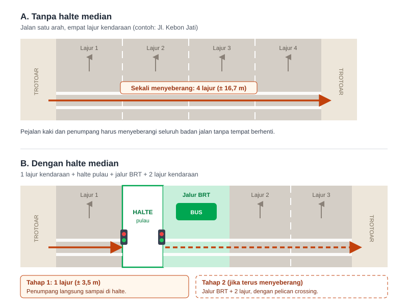

# Mengapa Sebagian Halte BRT Berada di Tengah Jalan?

Kawasan Metropolitan Cekungan Bandung akan segera memiliki layanan *bus rapid transit* (BRT). Melalui proyek MASTRAN (*Indonesia Mass Transit Project*), pemerintah membangun koridor BRT sepanjang 21,7 km dengan 38 halte *on-corridor*. Jaringan rutenya akan menjangkau lima daerah: Kota Bandung, Kota Cimahi, Kabupaten Bandung, Kabupaten Bandung Barat, dan Kabupaten Sumedang. Bank Dunia dan AFD (Prancis) membiayai proyek ini melalui pinjaman, dan layanannya nanti akan beroperasi dengan nama Metro Jabar Trans (MJT).

Kini, pembangunan halte mulai terlihat di sejumlah ruas jalan. Bagi warga yang melintas, bangunan setengah jadi di tengah jalan bisa tampak janggal: sebuah halte berdiri di antara lajur kendaraan, jauh dari trotoar, seolah menjadi pulau kecil di tengah arus lalu lintas. Wajar jika muncul pertanyaan. Bagaimana penumpang mencapainya? Bus mana yang akan berhenti di sana? Mengapa halte tidak berada di pinggir jalan seperti biasanya?

Jika berdiri sendiri, halte seperti ini memang tidak masuk akal. Namun, halte median bukan halte bus biasa. Halte ini merupakan satu bagian dari sistem BRT yang utuh. Sistem tersebut mencakup jalur khusus yang memisahkan bus dari kendaraan lain, separator fisik di sepanjang jalur, penyeberangan bagi pejalan kaki, pengaturan lampu lalu lintas di persimpangan, peron setinggi lantai bus, serta pembayaran di halte sebelum penumpang naik. Ketika semua komponen ini bekerja bersama, halte di tengah jalan justru menjadi salah satu kunci kecepatan BRT.

Istilah "BRT" mungkin sudah sering kita dengar. Namun, tidak semua orang tahu apa yang membedakan BRT dari bus kota biasa.

## Apa itu BRT?

ITDP (*Institute for Transportation and Development Policy*) menyusun *BRT Standard*, acuan internasional untuk merancang dan menilai koridor BRT. Dalam edisi 2024, ITDP mendefinisikan BRT sebagai sistem angkutan cepat berbasis bus berkapasitas tinggi yang memberikan layanan cepat, berkualitas, andal, aman, dan hemat biaya. Definisi yang sama langsung menyebut cara mencapainya: **jalur bus khusus yang berada di median jalan**, pembayaran di luar bus, peron setinggi lantai bus, prioritas bus di persimpangan, serta operasi yang cepat dan sering. Artinya, posisi jalur di tengah jalan bukan sekadar pilihan desain. ITDP menjadikannya bagian dari definisi BRT itu sendiri.

Kata kuncinya ada pada huruf R: *rapid*, atau cepat. Kemacetan, kendaraan yang berhenti atau berbelok di depan bus, dan antrean penumpang yang membayar ongkos satu per satu menyita banyak waktu perjalanan bus biasa. BRT mengejar kecepatan dengan menghilangkan sumber-sumber hambatan tersebut.

*BRT Standard* menyebut lima elemen dasar (*BRT Basics*) yang membedakan BRT dari layanan bus biasa:

1. **Jalur khusus** (*dedicated right-of-way*). Bus melaju di jalurnya sendiri, terpisah dari kendaraan lain, idealnya dengan separator fisik.
2. **Posisi jalur** (*busway alignment*). Jalur bus menempati bagian jalan dengan gangguan paling sedikit, umumnya di tengah jalan.
3. **Pembayaran di luar bus** (*off-board fare collection*). Penumpang membayar di halte sebelum naik, sehingga bus tidak perlu menunggu penumpang membayar.
4. **Penanganan persimpangan** (*intersection treatments*). Pengaturan lalu lintas di persimpangan mendahulukan bus, misalnya dengan melarang kendaraan lain berbelok memotong jalur BRT.
5. **Peron setinggi lantai bus** (*platform-level boarding*). Penumpang, termasuk pengguna kursi roda, dapat naik dan turun tanpa menaiki anak tangga.

ITDP juga menetapkan syarat minimum. Sebuah koridor baru memenuhi definisi BRT jika memiliki jalur khusus sepanjang minimal 3 km, meraih total minimal 20 dari 35 poin pada kelima elemen dasar, dan meraih minimal 4 dari 7 poin pada dua elemen sekaligus: **jalur khusus** dan **posisi jalur**. Nilai tinggi pada elemen lain tidak bisa menutupi kekurangan pada dua elemen ini.

Dengan kata lain, keberadaan jalur khusus saja belum cukup. Letak jalur tersebut di badan jalan ikut menentukan seberapa cepat, andal, dan aman sebuah layanan BRT. Elemen posisi jalur inilah yang menjadi alasan sebagian halte BRT Cekungan Bandung berada di tengah jalan.

## Dua posisi halte

Peta halte *on-corridor* BRT Cekungan Bandung menunjukkan dua posisi halte. Sebagian besar halte menempati **tepi jalan** (28 halte), sementara sepuluh halte lainnya berdiri di **median jalan**. Halte median ini berupa "halte pulau" yang berada di antara lajur kendaraan biasa dan jalur BRT. Mengapa tidak semua halte berada di tepi jalan, yang tampak lebih dekat bagi penumpang?

Jawabannya kembali ke prinsip *rapid* tadi: **bus harus bisa melaju tanpa gangguan kendaraan lain**. Untuk memahaminya, kita perlu melihat cara ITDP menilai posisi jalur.

## Cara ITDP menilai posisi jalur

*BRT Standard* 2024 memberi poin untuk setiap konfigurasi jalur. ITDP lalu menghitung nilai akhir koridor berdasarkan persentase panjang koridor yang memakai tiap konfigurasi.

| Konfigurasi jalur BRT | Poin |
|---|---|
| Jalur dua arah di median jalan dua arah | 7 |
| Koridor khusus bus tanpa lalu lintas kendaraan lain (misalnya *transit mall*) | 7 |
| Jalur di sisi jalan yang bersebelahan dengan taman, sungai, atau kawasan lain dengan sedikit persimpangan | 7 |
| Jalur dua arah di satu sisi jalan satu arah | 6 |
| Pasangan jalan satu arah, jalur BRT di tengah badan jalan | 5 |
| Jalur di tepi luar jalur utama pada jalan yang memiliki jalur lambat | 4 |
| Jalur di tepi dalam jalur lambat, dengan separator fisik | 3 |
| Pasangan jalan satu arah, jalur BRT di tepi jalan | 3 |
| Jalur virtual dua arah dalam satu lajur median | 1 |
| Jalur di tepi jalan dua arah | 0 |

Polanya cukup jelas. Secara umum, semakin jauh jalur BRT dari aktivitas di tepi jalan, semakin tinggi nilainya. Jalur di tepi jalan dua arah, konfigurasi yang paling umum di banyak kota, tidak mendapat poin sama sekali. ITDP merangkum alasannya dalam satu kalimat: semua konfigurasi yang mereka rekomendasikan bertujuan mengurangi risiko keterlambatan akibat konflik dengan kendaraan yang berbelok dan aktivitas di tepi jalan.

### Posisi jalur juga memengaruhi elemen lain

Pengaruh posisi jalur tidak berhenti pada elemen *busway alignment*. Beberapa elemen lain dalam *BRT Standard* juga bergantung pada letak jalur dan halte:

- **Halte tengah** (*center stations*, maksimal 2 poin). ITDP memberi poin untuk halte tunggal di tengah jalan yang melayani dua arah sekaligus. Halte seperti ini memudahkan penumpang berpindah arah, menekan biaya konstruksi, dan **mengurangi kebutuhan ruang jalan**, karena satu halte menggantikan dua. Koridor meraih 2 poin jika lebih dari 80 persen halte memakai peron tengah untuk dua arah, dan 1 poin jika lebih dari 50 persen. Koridor juga bisa meraih 1 poin jika lebih dari 80 persen halte berada di tengah, meskipun hanya melayani satu arah.
- **Profil permintaan** (*demand profile*, maksimal 3 poin). ITDP meminta agar ruas dengan permintaan penumpang tertinggi memiliki jalur khusus dengan posisi jalur terbaik. Nilainya mengikuti tingkatan konfigurasi pada tabel di atas: 3 poin untuk konfigurasi tingkat 1 (misalnya jalur dua arah di median), 2 poin untuk tingkat 2 (misalnya pasangan jalan satu arah), dan 1 poin untuk tingkat 3.
- **Akses dan keselamatan pejalan kaki** (*pedestrian access and safety*, maksimal 4 poin). Salah satu syaratnya: pejalan kaki maksimal menyeberangi dua lajur sebelum mencapai tempat berlindung yang terlindungi secara fisik, seperti trotoar atau median. Halte median dapat berfungsi sebagai tempat berlindung tersebut. Bagian keselamatan di bawah membahas syarat ini lebih lanjut.
- **Pengurangan nilai operasional.** *BRT Standard* juga mengurangi nilai koridor yang sudah beroperasi jika kendaraan lain sering menyerobot jalur BRT (hingga -7 poin), jika kecepatan komersial bus di bawah 20 km/jam (hingga -10 poin), dan jika terjadi kematian pejalan kaki atau pesepeda di sepanjang koridor (hingga -2 poin). Posisi jalur yang baik membantu koridor menghindari ketiga pengurangan ini.

## Masalah utama jalur dan halte di tepi jalan

Di jalan perkotaan, lajur paling kiri hampir selalu menjadi lajur tersibuk. Angkot berhenti untuk mengambil penumpang, ojek menunggu pesanan, mobil parkir, kendaraan menurunkan barang, dan kendaraan lain keluar-masuk toko, gang, atau SPBU. Jika jalur BRT menempati lajur kiri, bus harus berbagi ruang dengan semua aktivitas tersebut, meskipun jalurnya sudah memiliki marka atau separator.

Akibatnya:

- **Kendaraan lain mudah menghalangi jalur.** *BRT Planning Guide* dari ITDP menggambarkan risiko ini dengan lugas: satu taksi yang berhenti sudah cukup untuk menutup seluruh jalur bus.
- **Setiap akses menimbulkan konflik.** Gang, halaman, dan putaran yang bermuara ke jalan utama memaksa kendaraan lain memotong jalur BRT.
- **Kendaraan yang belok kiri memotong jalur bus.** Di Indonesia, kendaraan melaju di lajur kiri. Artinya, jalur BRT di tepi jalan berada tepat di jalur kendaraan yang hendak belok kiri. Di setiap persimpangan, kendaraan ini harus melintasi jalur BRT, sehingga bus terpaksa menunggu atau berisiko bersenggolan.
- **Kapasitasnya terbatas.** *BRT Planning Guide* mencatat bahwa jalur tepi sulit melayani lebih dari 5.000 penumpang per jam per arah.

## Keuntungan jalur dan halte di tengah jalan

Memindahkan jalur BRT ke tengah jalan menghilangkan sebagian besar gangguan tersebut. Keuntungannya mencakup beberapa aspek yang saling berkaitan.

### Kecepatan dan keandalan

*BRT Standard* mencatat bahwa jalur di median menghadapi lebih sedikit konflik dengan kendaraan yang berbelok, karena median berada jauh dari gang, area parkir, dan kebutuhan bongkar muat. Taksi dan kendaraan pengantar barang membutuhkan akses ke tepi jalan, sedangkan bagian tengah jalan umumnya bebas dari hambatan semacam itu. Bus dapat menjaga kecepatan dan ketepatan waktu.

### Keselamatan

Kajian Duduta dkk. (2012) terhadap sembilan sistem BRT dan *busway* menemukan bahwa sistem dengan jalur di tengah jalan umumnya lebih aman daripada sistem dengan jalur di tepi jalan. Kajian yang sama menempatkan jalur lawan arus (*contraflow*) sebagai konfigurasi paling berbahaya. Laporan WRI tahun 2015 juga mencatat bahwa penambahan median di sebuah jalan berkaitan dengan penurunan kecelakaan fatal dan kecelakaan dengan korban luka sebesar 35 persen.

Namun, banyak warga justru mengkhawatirkan hal sebaliknya: halte di tengah jalan tampak lebih berbahaya. Bagian khusus di bawah membahas kekhawatiran ini secara lebih rinci.

### Efisiensi

Pada jalan dua arah, satu halte pulau di median dapat melayani bus dari dua arah sekaligus. Penumpang bisa berpindah rute tanpa menyeberang jalan, dan pemerintah cukup membangun satu halte, bukan dua. Penghematan ini mencakup lahan, biaya konstruksi, dan petugas. Namun, BRT Cekungan Bandung tidak memakai halte bersama seperti ini. Bagian tentang jalan satu arah di bawah menjelaskan alasannya.

### Penegakan aturan

Jalur di tengah jalan dengan separator fisik menjaga dirinya sendiri. Pengendara lain tidak bisa begitu saja masuk ke jalur tersebut untuk parkir atau berhenti. *BRT Standard* bahkan mencatat bahwa pada beberapa desain, halte itu sendiri dapat berfungsi sebagai pembatas jalur. Halte pulau di median memisahkan jalur BRT dari lajur kendaraan umum di sepanjang area halte. Sebaliknya, jalur di tepi jalan bersebelahan langsung dengan trotoar dan pertokoan, sehingga petugas harus terus-menerus mengawasinya.

### Trotoar tetap milik pejalan kaki

Halte BRT jauh lebih besar daripada halte bus biasa. Data halte *on-corridor* mencatat luas halte hingga lebih dari 200 meter persegi, misalnya Halte Dalam Kaum (sekitar 230 m²) dan Halte Taman Tegallega Sisi Utara (sekitar 223 m²). Halte tepi harus menempati ruang di sisi jalan, sehingga halte ini bersaing dengan trotoar. Karena itu, ESIA proyek ini menyebut bahwa perencana hanya menempatkan halte tepi di ruas yang memiliki trotoar memadai.

Masalahnya, banyak trotoar di pusat Kota Bandung masih sempit. Menurut kajian Analisis Dampak Lalu Lintas, trotoar sisi kiri Jalan Kebon Jati hanya selebar sekitar 1,8 meter, dan ruas ini juga memiliki area parkir di badan jalan. Halte tepi di ruas seperti ini akan memakan trotoar yang sudah sempit, atau memaksa pejalan kaki berjalan di sela antrean penumpang. Di ruas yang sama, BRT Cekungan Bandung menempatkan halte median, antara lain Halte Stasiun Hall.

*BRT Standard* menetapkan trotoar selebar minimal 3 meter yang bebas hambatan sebagai salah satu ciri akses pejalan kaki yang baik. Halte median memakai ruang di badan jalan, bukan di trotoar. Dengan begitu, trotoar tetap menjadi ruang bagi pejalan kaki, dan penumpang yang menunggu bus tidak menghalangi orang yang sekadar lewat. ESIA juga mencatat potensi kerumunan pejalan kaki di sekitar halte saat BRT beroperasi. Pada halte median, kerumunan ini berada di peron halte, bukan di trotoar.

### Halte yang lebih mudah dikendalikan

Halte pulau di median memiliki batas yang jelas: jalur BRT di satu sisi, lajur kendaraan di sisi lain, dan akses masuk melalui penyeberangan. Batas alami ini memudahkan pengelola mengatur arus penumpang di halte. WRI menyebut halte tertutup dengan akses terkendali, yang mengarahkan pejalan kaki ke penyeberangan berlampu, sebagai konfigurasi halte paling aman.

Batas yang jelas ini juga membuka peluang bagi dua elemen dasar BRT lainnya. Jika BRT Cekungan Bandung menerapkan pembayaran di luar bus, halte median dapat berfungsi sebagai area berbayar dengan pintu masuk yang terkendali, tanpa mengganggu pejalan kaki di trotoar. Sebaliknya, halte tepi bersebelahan langsung dengan trotoar, sehingga pengelola sulit menutupnya tanpa memotong jalur pejalan kaki. [CEK: metode pembayaran BRT Cekungan Bandung]

## Apakah halte di tengah jalan berbahaya?

Kekhawatiran ini sering muncul: halte median berdiri di antara arus kendaraan, sehingga kendaraan yang hilang kendali bisa menabraknya, dan penumpang di dalamnya tidak punya tempat untuk menghindar. Kekhawatiran ini wajar, terutama bagi warga yang melihat halte setengah jadi tanpa komponen BRT lainnya. Namun, data keselamatan dari berbagai koridor bus di dunia memberi gambaran yang lebih utuh.

### Di mana kecelakaan di koridor bus sebenarnya terjadi?

WRI menganalisis data kecelakaan dari lebih dari tiga puluh koridor bus di berbagai negara dalam laporan *Traffic Safety on Bus Priority Systems* (2015). Beberapa temuannya penting untuk kita catat:

- Hanya sekitar **9 persen** kecelakaan terjadi di jalur bus. Sebagian besar kecelakaan terjadi di lajur kendaraan umum dan tidak melibatkan bus.
- Pejalan kaki hanya terlibat dalam 7 persen kecelakaan yang tercatat, tetapi mencakup **54 persen korban jiwa**.
- Di Porto Alegre, Brasil, **93 persen** kecelakaan pejalan kaki terjadi di tengah ruas jalan, bukan di persimpangan.

Dengan kata lain, risiko terbesar di koridor bus bukan tabrakan kendaraan ke halte, melainkan **pejalan kaki yang menyeberang jalan**. Cara terbaik untuk menilai keselamatan halte median adalah dengan melihat pengaruhnya terhadap pejalan kaki, baik yang berjalan di trotoar maupun yang menyeberang.

### Bus menjauh dari trotoar dan akses bangunan

Pada jalur tepi, bus besar melaju tepat di samping trotoar. Bus berbagi ruang dengan pejalan kaki yang turun ke badan jalan, angkot yang berhenti, dan kendaraan yang keluar-masuk toko, rumah, dan gang. Setiap pertemuan tersebut merupakan titik konflik.

Jalur dan halte median memindahkan bus ke tengah, jauh dari semua aktivitas itu. Pejalan kaki di trotoar tidak lagi berhadapan langsung dengan bus yang melaju, dan kendaraan dari akses bangunan tidak perlu memotong jalur bus. WRI mencatat bahwa jalur bus tepi di Guadalajara, Meksiko, berkaitan dengan kenaikan angka kecelakaan kendaraan maupun pejalan kaki.

### Halte median berfungsi sebagai pulau penyeberangan

Halte median yang terhubung dengan penyeberangan memberi pejalan kaki **tempat berhenti di tengah jalan**. Pejalan kaki dapat menyeberang dalam dua tahap: menyeberangi lajur kendaraan menuju halte, lalu menunggu dengan aman sebelum melanjutkan. Pada setiap tahap, pejalan kaki hanya perlu memperhatikan lebih sedikit lajur.

Bukti tentang manfaat pulau penyeberangan cukup kuat:

- WRI menemukan bahwa setiap tambahan **1 meter jarak penyeberangan meningkatkan risiko kecelakaan pejalan kaki sebesar 6 persen**.
- Pulau penyeberangan dapat memangkas jarak yang harus pejalan kaki tempuh dalam sekali menyeberang hingga 10 meter di jalan arteri. Menurut WRI, langkah ini dapat menurunkan kecelakaan fatal dan kecelakaan dengan korban luka di lokasi tersebut hingga 35 persen.
- Federal Highway Administration (FHWA) Amerika Serikat mencatat bahwa median atau pulau penyeberangan pada penyeberangan bermarka berkaitan dengan penurunan kecelakaan pejalan kaki sebesar 46 persen.

ITDP menuangkan prinsip yang sama ke dalam elemen akses dan keselamatan pejalan kaki pada *BRT Standard*. Koridor BRT yang baik memiliki ciri-ciri berikut:

- Pejalan kaki **maksimal menyeberangi dua lajur** sebelum mencapai tempat berlindung yang terlindungi secara fisik, seperti trotoar atau median.
- Penyeberangan sebidang tersedia **setidaknya setiap 200 meter** di kawasan terbangun.
- Penyeberangan **memakai lampu lalu lintas** jika pejalan kaki harus menyeberangi lebih dari dua lajur sekaligus.
- Penyeberangan tanpa lampu memakai *speed table* atau polisi tidur untuk memperlambat kendaraan.
- Waktu tunggu pejalan kaki di lampu penyeberangan umumnya tidak lebih dari 30 sampai 45 detik.
- Penyeberangan selebar minimal 2 meter, terang, dan bermarka jelas.

ITDP juga **sangat tidak menganjurkan jembatan penyeberangan atau terowongan**, kecuali dalam kondisi ekstrem seperti jalan bebas hambatan. Dengan kata lain, standar BRT internasional justru mengandalkan penyeberangan sebidang yang aman, dan halte median merupakan bagian dari solusi tersebut.

### Tanpa halte median, penumpang tetap menyeberang

Penumpang tetap perlu menyeberang jalan, di mana pun letak haltenya. Penumpang yang turun di halte tepi dan memiliki tujuan di seberang jalan tetap harus menyeberang. Bedanya, tanpa halte median sebagai pulau penyeberangan, penumpang harus menyeberangi **seluruh lebar jalan dalam sekali jalan**.

Ruas koridor BRT di Bandung umumnya memiliki lebar jalur lalu lintas sekitar 10 hingga 17 meter, bahkan lebih di beberapa ruas. Jalan Jakarta, misalnya, memiliki jalur lalu lintas selebar 14 meter dengan empat lajur satu arah. Menyeberangi empat lajur sekaligus jauh lebih berisiko daripada menyeberangi satu atau dua lajur, lalu berhenti di halte. Penyeberangan empat lajur tanpa tempat berlindung juga tidak memenuhi kriteria "maksimal dua lajur" dalam *BRT Standard*. Dengan angka WRI tadi, perbedaan beberapa meter saja sudah berpengaruh nyata terhadap risiko kecelakaan.

*Gambar: ilustrasi jarak penyeberangan pada jalan satu arah empat lajur. Tanpa halte median, pejalan kaki menyeberangi seluruh badan jalan sekaligus. Dengan halte median, penumpang cukup menyeberangi satu lajur untuk mencapai halte, dan pejalan kaki yang ingin terus menyeberang memiliki tempat berhenti di tengah. Ukuran lajur bersifat ilustratif, bukan gambar DED.*

WRI juga memberi peringatan penting. Salah satu jenis kecelakaan fatal yang paling sering melibatkan bus BRT terjadi ketika pejalan kaki menyeberang di sela kendaraan yang macet, lalu tertabrak bus di jalur BRT yang lengang. Karena itu, halte median harus terhubung dengan penyeberangan resmi yang jelas, dan desain halte perlu mencegah orang menyeberang sembarangan, misalnya dengan pagar pengarah.

### Pergeseran lajur dan pelican crossing memperlambat kendaraan

Desain halte median menggeser lajur kendaraan umum menjauh dari area halte. [CEK: detail pergeseran lajur dan jarak taper pada gambar DED halte median] Selain menjaga jarak antara kendaraan dan halte, pergeseran ini juga membuat pengemudi menurunkan kecepatan, karena mereka harus mengikuti lengkungan jalan sebelum dan sesudah halte. Panduan desain jalan perkotaan NACTO menyebut pergeseran lajur sebagai salah satu cara membelokkan lintasan kendaraan (*horizontal deflection*) untuk menurunkan kecepatan.

Penyeberangan berlampu dengan tombol (*pelican crossing*) di dekat halte menambah efek yang sama. Pengemudi harus berhenti saat lampu merah menyala untuk pejalan kaki. WRI merekomendasikan agar penyeberangan di tengah ruas jalan arteri selalu memakai lampu lalu lintas, dan mencatat bahwa pengemudi lebih mau memberi jalan kepada pejalan kaki ketika mereka melaju lebih lambat.

Kecepatan yang lebih rendah sangat menentukan keselamatan. Menurut WRI, yang mengutip Rosén dan Sander (2009), risiko kematian pejalan kaki pada kecepatan tabrak 50 km/jam lebih dari dua kali lipat risiko pada 40 km/jam. Koridor BRT di Bandung melintasi pertokoan, pasar, sekolah, rumah sakit, dan permukiman. Di lingkungan seperti ini, kendaraan yang melaju lebih lambat menciptakan jalan yang lebih aman bagi semua orang. Manfaat ini berkaitan langsung dengan poin sebelumnya: jalan kota merupakan ruang aktivitas warga, bukan sekadar ruang lewat kendaraan.

Desain koridor juga melindungi jalur bus secara fisik. ESIA proyek ini menyebut pemasangan pembatas setinggi sekitar 50 cm pada sejumlah segmen jalur BRT. Pembatas ini mencegah kendaraan lain masuk ke jalur bus dan menyerap energi saat kendaraan menabraknya. ESIA juga merekomendasikan pengendalian kecepatan hingga 30 km/jam di dekat sekolah, rumah sakit, dan permukiman.

### Jalan kota bukan jalan tol

Kekhawatiran terhadap halte median sering berangkat dari cara pandang tertentu: jalan kota seharusnya selebar dan selengang mungkin agar kendaraan bisa melaju kencang. Banyak pengendara memperlakukan jalan dalam kota seperti jalan bebas hambatan, sehingga mereka menganggap halte, penyeberangan, dan pergeseran lajur sebagai penghalang.

Cara pandang ini keliru. Peraturan Menteri Perhubungan Nomor PM 111 Tahun 2015 membatasi kecepatan maksimal di kawasan perkotaan pada 50 km/jam, dan di kawasan permukiman pada 30 km/jam. WRI menyarankan kecepatan sekitar 50 km/jam untuk jalan arteri perkotaan dan 20 hingga 30 km/jam untuk jalan di pusat kota dengan banyak pejalan kaki. *BRT Standard* sendiri meminta batas kecepatan yang mengutamakan keselamatan, misalnya di bawah 30 km/jam di pusat kota yang padat, serta desain jalan yang selaras dengan batas kecepatan tersebut agar pengendara tidak terdorong untuk ngebut. *Global Street Design Guide* dari Global Designing Cities Initiative bahkan menegaskan bahwa kecepatan rencana jalan perkotaan sebaiknya tidak melebihi 40 km/jam, dan perencana tidak boleh memakai praktik desain jalan bebas hambatan di kawasan perkotaan.

Jalan kota melayani orang yang berjalan kaki, berbelanja, menyeberang, menunggu angkutan umum, dan keluar-masuk rumah maupun toko. Elemen yang membuat pengendara memperlambat laju kendaraannya di jalan seperti ini bukan cacat desain. Elemen tersebut justru menjalankan fungsinya.

### Mengapa bukan jembatan penyeberangan?

Banyak warga terbiasa dengan pola halte TransJakarta, yang sebagian besar penumpangnya mencapai halte median lewat jembatan penyeberangan orang (JPO) dengan tangga atau ramp panjang. Karena itu, sebagian orang mungkin bertanya mengapa halte median di Bandung tidak memakai JPO.

BRT Cekungan Bandung memilih jalan lain. **Seluruh penyeberangan menuju halte median di Bandung memakai *pelican crossing***, yaitu penyeberangan sebidang dengan lampu lalu lintas yang pejalan kaki aktifkan melalui tombol. Pilihan ini sejalan dengan rekomendasi ITDP dan bukti keselamatan yang ada.

- ***BRT Standard* sangat tidak menganjurkan JPO dan terowongan penyeberangan.** ITDP hanya menerimanya dalam kondisi ekstrem, seperti di jalan bebas hambatan dengan akses terbatas.
- **Penyeberangan sebidang paling nyaman bagi pejalan kaki.** *BRT Planning Guide* menyebut penyeberangan sebidang sebagai cara paling nyaman untuk mencapai halte BRT, termasuk bagi penyandang disabilitas. Panduan ini menyimpulkan bahwa akses halte BRT umumnya harus sebidang.
- **Tangga menyingkirkan sebagian penumpang.** Jika penumpang harus menaiki tangga, banyak orang tidak dapat memakai fasilitas tersebut, termasuk pengguna kursi roda, lansia, dan orang tua yang mendorong kereta bayi. Ramp bisa membantu, tetapi WRI mencatat bahwa kemiringan ramp tidak boleh lebih dari 10 persen, idealnya mendekati 5 persen. Karena JPO harus cukup tinggi untuk dilewati kendaraan besar, rampnya menjadi sangat panjang.
- **Orang enggan memakai JPO yang memutar.** Mengutip kajian Institute of Transportation Engineers (1998), *BRT Planning Guide* mencatat bahwa sekitar 70 persen pejalan kaki mau memakai jembatan penyeberangan jika waktu tempuhnya sama dengan menyeberang sebidang. Namun, hampir tidak ada yang mau memakainya jika waktu tempuhnya 50 persen lebih lama. Pejalan kaki juga menghindari JPO yang letaknya kurang tepat, terlalu curam, kurang terawat, atau rawan kejahatan.
- **JPO tidak efektif di jalan arteri perkotaan.** Analisis WRI menunjukkan bahwa JPO efektif menurunkan kecelakaan pejalan kaki di jalan bebas hambatan, tetapi tidak efektif di jalan arteri perkotaan. Penyebabnya sederhana: pejalan kaki merasa lebih praktis menyeberang di bawah jembatan, bahkan sampai melompati pagar pembatas. WRI menyarankan JPO hanya untuk jalan berkecepatan tinggi yang tidak memungkinkan penyeberangan berlampu.

Jakarta sendiri pernah mengganti sejumlah JPO dengan *pelican crossing*. Pada 2018, misalnya, Pemerintah Provinsi DKI Jakarta mengganti JPO di Halte Tosari dengan *pelican crossing* agar penyandang disabilitas lebih mudah menyeberang.

*Pelican crossing* juga membawa manfaat tambahan yang berkaitan dengan bagian sebelumnya. Lampu merah untuk pejalan kaki memaksa kendaraan berhenti secara berkala, sehingga kecepatan kendaraan di sekitar halte ikut turun. Agar manfaat ini terwujud, *pelican crossing* harus benar-benar berfungsi: lampunya menyala, waktu tunggu pejalan kaki tidak terlalu lama (*BRT Standard* menyarankan umumnya di bawah 30 sampai 45 detik), dan pengendara mematuhi lampu merah. WRI mengingatkan bahwa kepatuhan pengendara terhadap lampu penyeberangan sangat beragam antarkota, sehingga penegakan aturan tetap penting.

### Risiko tetap ada, dan desain harus menjawabnya

Semua penjelasan di atas tidak berarti halte median bebas risiko. Kendaraan tetap bisa hilang kendali, dan pejalan kaki tetap bisa menyeberang sembarangan. Desain halte dan koridor perlu menjawab risiko tersebut, antara lain melalui:

- **Pembatas fisik dan bolar** di sekitar halte untuk menahan kendaraan yang keluar jalur.
- **Penerangan dan rambu** yang membuat halte dan penyeberangan terlihat jelas dari kejauhan, termasuk pada malam hari.
- **Penyeberangan berlampu** yang terhubung langsung dengan pintu masuk halte.
- **Halte tertutup dengan akses terkendali.** WRI menyebut halte tertutup yang mengarahkan pejalan kaki ke penyeberangan berlampu sebagai konfigurasi paling aman.
- **Pagar pengarah** yang mencegah orang menyeberang di luar penyeberangan resmi.

[CEK: elemen pelindung halte median pada DED, misalnya kerb, bolar, dan pembatas]

## Lebih cepat atau lebih lambat?

Sampai di sini, sebagian pembaca mungkin merasa ada yang janggal. Di awal, tulisan ini menyebut BRT sebagai angkutan yang cepat, dan jalur di tengah jalan sebagai kunci kecepatannya. Namun, bagian keselamatan justru memuji halte median karena memperlambat kendaraan. Mana yang benar: lebih cepat atau lebih lambat?

Keduanya benar, karena keduanya menjawab pertanyaan yang berbeda. Kuncinya ada pada pertanyaan sederhana: **cepat untuk siapa, dan di mana?**

### Kecepatan BRT bukan soal ngebut

BRT tidak menjadi cepat karena busnya melaju kencang. BRT menjadi cepat karena busnya **jarang berhenti selain di halte**. *BRT Standard* menjelaskan bahwa kelima elemen dasar BRT bertujuan menghilangkan sumber keterlambatan: kemacetan, konflik dengan kendaraan lain, dan waktu naik-turun penumpang. Desain koridor BRT Cekungan Bandung sendiri memakai kecepatan rencana minimal 40 km/jam untuk jalur BRT, jauh dari kecepatan jalan tol.

Ukuran keberhasilannya pun bukan kecepatan puncak, melainkan kecepatan rata-rata dari ujung ke ujung koridor, termasuk waktu berhenti di halte dan di lampu merah. *BRT Standard* baru mengurangi nilai koridor jika kecepatan komersial busnya turun di bawah 20 km/jam. Angka ini terdengar biasa saja, tetapi bandingkan dengan kondisi jalan saat ini.

### Jalan Bandung hari ini sudah lambat

Kajian Analisis Dampak Lalu Lintas proyek MASTRAN mengukur kecepatan kendaraan di ruas-ruas yang akan menjadi koridor BRT. Pada jam sibuk sore, **separuh pengukuran menunjukkan kecepatan di bawah 10 km/jam**, dan 39 dari 50 pengukuran berada di bawah 15 km/jam. Beberapa ruas, seperti Jalan Suniaraja dan Jalan Alun-alun Timur, hanya mencatat sekitar 4 km/jam, hampir setara dengan orang berjalan kaki. [CEK: Tabel III-78, cocokkan baris dan ruas]

Artinya, rasa "bisa ngebut" di jalan kota hanya muncul sesaat, di sela antrean dari satu lampu merah ke lampu merah berikutnya. Waktu perjalanan kendaraan pribadi lebih banyak habis di antrean persimpangan, di belakang kendaraan yang berhenti, dan di tengah hambatan samping. Memperlambat kendaraan beberapa puluh meter di sekitar halte hampir tidak mengubah waktu tempuh mereka. Sebaliknya, bus yang tidak lagi ikut mengantre bisa memangkas waktu tempuh penumpangnya secara nyata.

### Ukurannya orang, bukan kendaraan

Perbedaan cara pandang ini terlihat jelas saat kita menghitung berapa banyak orang yang dapat melintas di satu lajur jalan. Menurut *Transit Street Design Guide* dari NACTO, satu lajur kendaraan pribadi di jalan kota memindahkan sekitar 600 hingga 1.600 orang per jam. Satu lajur bus khusus dapat memindahkan hingga sekitar 8.000 orang per jam, dan jalur angkutan massal seperti BRT bisa mencapai 10.000 hingga 25.000 orang per jam per arah.

Jika ukurannya kendaraan, jalan yang baik adalah jalan tempat mobil bisa melaju kencang. Jika ukurannya orang, jalan yang baik adalah jalan yang bisa memindahkan sebanyak mungkin orang dengan cepat, aman, dan nyaman. Kota bisa saja memiliki mobil yang melaju lebih lambat, tetapi warga yang sampai di tujuan lebih cepat.

### Satu orang, dua peran

Setiap penumpang BRT adalah pejalan kaki. Mereka berjalan dari rumah ke halte, menyeberang menuju halte median, lalu berjalan lagi dari halte ke tempat tujuan. Orang yang menikmati bus yang cepat adalah orang yang sama yang membutuhkan kendaraan melambat saat ia menyeberang.

Karena itu, desain koridor BRT membagi kecepatan sesuai tempatnya. Bus melaju lancar di jalur khusus di antara halte, tempat tidak ada orang yang berjalan. Kendaraan melambat di sekitar halte, penyeberangan, pasar, dan sekolah, tempat orang berkumpul dan menyeberang. Bahkan bus pun perlu melambat di tempat seperti ini. WRI menyarankan kecepatan bus yang lebih rendah di jalan pusat kota yang sempit dan ramai pejalan kaki, agar pengemudi punya cukup waktu untuk bereaksi.

### Kota untuk manusia

Pada akhirnya, "cepat" dan "lambat" dalam tulisan ini melayani tujuan yang sama. Kota yang berpusat pada mobil bertanya: seberapa kencang mobil bisa melaju? Kota yang berpusat pada manusia bertanya: seberapa cepat, aman, dan nyaman seseorang bisa sampai di tujuannya?

BRT dengan halte di tengah jalan menjawab pertanyaan kedua. Bus melaju lancar agar penumpang menghemat waktu, dan kendaraan lain melambat agar penumpang yang sama bisa menyeberang dengan selamat. Keduanya bukan kontradiksi, melainkan dua sisi dari jalan yang mengutamakan manusia.

## Bukti dari kota lain, dan dari kajian Bandung sendiri

Argumen di atas bukan sekadar teori. Sejumlah kota sudah membangun BRT dengan jalur di tengah jalan, dan hasilnya terukur.

### Lebih sedikit korban

WRI mengukur dampak keselamatan beberapa sistem BRT dengan jalur di tengah jalan. Metodenya tidak sekadar membandingkan angka sebelum dan sesudah. WRI membandingkan kondisi setelah BRT beroperasi dengan perkiraan kondisi jika BRT tidak pernah dibangun, lalu menyesuaikan data dengan faktor koreksi dari WHO untuk kecelakaan yang tidak tercatat. Hasilnya:

| Kota dan koridor | Kondisi sebelumnya | Korban luka | Korban jiwa |
|---|---|---|---|
| Guadalajara, Macrobús | Lajur prioritas bus | -69% | -68% |
| Bogotá, Avenida Caracas (TransMilenio) | *Busway* sederhana | -39% | -48% |
| Mexico City, Metrobús Jalur 3 | Angkutan informal | -38% | -38% |
| Ahmedabad, Janmarg | Angkutan informal | -28% | -55% |

Kasus Guadalajara sangat relevan. Kota ini sebelumnya hanya memiliki lajur prioritas bus, lalu meningkatkannya menjadi BRT penuh dengan jalur di tengah jalan. Jumlah kecelakaan di koridor tersebut turun 56 persen.

### Lebih cepat bagi penumpang

Kajian ekonomi TransMilenio oleh Echeverry dan rekan-rekan (2005) mencatat bahwa sistem ini memangkas waktu perjalanan penggunanya sebesar 32 persen. Dua tahun setelah TransMilenio beroperasi, rata-rata waktu perjalanan di Bogotá turun dari 44 menjadi 35 menit, dan kecepatan rata-rata mobil justru naik dari sekitar 27 menjadi 32 km/jam.

Kajian yang sama juga memberi pelajaran penting. Bogotá memindahkan bus-bus lama yang tergusur dari koridor TransMilenio ke koridor lain, sehingga kemacetan di koridor tersebut justru memburuk. Manfaat BRT bergantung pada penataan angkutan umum di sekitarnya, termasuk angkot yang rutenya tumpang tindih dengan koridor BRT. Kajian Analisis Dampak Lalu Lintas proyek MASTRAN sendiri mencatat 44 trayek angkutan umum yang perlu diintegrasikan dengan layanan BRT.

### Kajian Bandung: arus lalu lintas bisa membaik

Kajian Analisis Dampak Lalu Lintas proyek MASTRAN membandingkan dua skenario untuk tahun 2027 di ruas-ruas koridor BRT, dengan memakai rasio volume terhadap kapasitas (*V/C ratio*). Rasio di atas 1,0 berarti volume kendaraan melebihi kapasitas jalan.

| Kondisi | Rata-rata V/C jam sibuk pagi | Rata-rata V/C jam sibuk sore | Ruas dengan V/C ≥ 1,0 (pagi) |
|---|---|---|---|
| 2024 (kondisi saat ini) | 0,85 | 0,84 | 1 dari 45 |
| 2027 tanpa BRT | 0,98 | 0,98 | 21 dari 45 |
| 2027 dengan BRT | 0,65 | 0,64 | 0 dari 45 |

Tanpa BRT, hampir separuh ruas koridor akan melampaui kapasitasnya pada 2027. Dengan BRT dan langkah pendukungnya, kajian ini memperkirakan seluruh ruas berada di bawah kapasitas, bahkan lebih lancar daripada kondisi saat ini. Artinya, desain koridor ini, termasuk halte median, sudah melalui analisis dampak lalu lintas dan berpotensi mengurangi kemacetan.

Namun, hasil ini bergantung pada sejumlah asumsi yang harus terwujud. Skenario "dengan BRT" mengasumsikan perbaikan fase lampu lalu lintas di persimpangan sepanjang koridor, operasi penuh seluruh rute BRT pada 2027, kenaikan porsi pengguna angkutan umum menjadi 15 persen, serta kebijakan pembatasan jam operasional kendaraan pribadi di ruas-ruas utama yang menurunkan volume kendaraan pribadi sebesar 20 persen. Kajian tersebut juga menyebut bahwa kebijakan pembatasan ini masih memerlukan studi lebih lanjut. Dengan kata lain, BRT bisa mengurangi kemacetan **jika seluruh rencana berjalan sesuai rencana**, dan hal ini perlu kita kawal bersama. [CEK: Gambar IV-76 dan Gambar V-1, cocokkan nilai per ruas]

## Mengapa tidak semua halte berada di tengah?

Halte median membutuhkan **ruang**. Halte pulau memerlukan lebar tambahan di tengah jalan, ditambah lajur BRT di sampingnya, sementara jalan tetap harus menyisakan lajur untuk kendaraan biasa. Banyak ruas jalan di Bandung tidak memiliki lebar sebesar itu. Tanpa pelebaran jalan, yang berarti pemerintah harus membebaskan lahan, halte median di jalan sempit justru akan menghabiskan lajur kendaraan umum.

Selain lebar jalan, beberapa faktor lain ikut menentukan posisi halte:

- **Akses pejalan kaki.** Penumpang harus menyeberang untuk mencapai halte median. Halte ini membutuhkan penyeberangan sebidang yang aman. Di Bandung, seluruh halte median memakai *pelican crossing*. Tanpa fasilitas itu, halte median justru membahayakan penumpang.
- **Keberadaan median.** Ruas yang sudah memiliki median lebar memudahkan pembangunan koridor median.
- **Pola belokan di persimpangan.** Pengelola lalu lintas perlu menata ulang arus belok kanan agar kendaraan tidak memotong jalur BRT di tengah.
- **Volume sepeda motor.** ESIA proyek ini mencatat bahwa perencana menyesuaikan konfigurasi lajur dengan tingginya volume sepeda motor dan keterbatasan ruang jalan di Bandung.
- **Dampak lalu lintas selama dan sesudah konstruksi.** [CEK: Analisis Penanganan Dampak Lalu Lintas, ruas mana saja yang menurut kajian layak memakai median]

ESIA juga merangkum prinsip yang perencana pakai sejak studi kelayakan: halte median di jalan yang lebar, halte tepi di ruas dengan trotoar yang memadai, dan halte searah di jalan satu arah. Faktor terakhir ini membawa kita ke ciri khas jaringan jalan Bandung.

## Bandung: kota dengan banyak jalan satu arah

Pusat Kota Bandung memiliki jaringan jalan satu arah yang padat. Kajian Analisis Dampak Lalu Lintas proyek MASTRAN mencatat 29 ruas jalan yang akan menampung jalur khusus BRT. Dari jumlah itu, **22 ruas merupakan jalan satu arah**, dan hanya tujuh ruas yang melayani dua arah. Jalan Ahmad Yani, misalnya, terbagi menjadi dua ruas terpisah untuk masing-masing arah. Jalan Asia Afrika, Jalan Jenderal Sudirman, Jalan Rajawali Barat, Jalan Rajawali Timur, Jalan Kebon Jati, dan Jalan Otto Iskandardinata juga merupakan jalan satu arah.

Kondisi ini membatasi pilihan konfigurasi. Pada jalan satu arah, konfigurasi "jalur dua arah di median jalan dua arah" yang bernilai 7 tidak tersedia. Perencana hanya memiliki tiga pilihan utama:

1. **Jalur dua arah di satu sisi jalan satu arah (6 poin).** Salah satu arah bus melaju melawan arus kendaraan lain. Nilainya tinggi, tetapi *BRT Planning Guide* mengingatkan bahwa pejalan kaki tidak terbiasa menoleh ke arah lawan arus. Kajian Duduta dkk. pun menempatkan jalur lawan arus sebagai konfigurasi paling berbahaya.
2. **Pasangan jalan satu arah dengan jalur BRT di tengah badan jalan (5 poin).** Bus melaju searah arus kendaraan lain, di lajur yang tidak bersebelahan dengan trotoar.
3. **Pasangan jalan satu arah dengan jalur BRT di tepi jalan (3 poin).** Bus melaju searah arus, di lajur paling kiri yang bersebelahan dengan trotoar.

*BRT Planning Guide* juga mencatat kelebihan pasangan jalan satu arah: dampaknya terhadap lalu lintas kendaraan lain, parkir, dan bongkar muat lebih kecil, dan rutenya sering mengikuti rute bus yang sudah ada. Kekurangannya, penumpang bisa bingung karena halte untuk arah pergi dan arah pulang berada di jalan yang berbeda.

### Bukan konfigurasi baru

Jalur BRT di tengah jalan satu arah bukan eksperimen khas Bandung. Beberapa sistem BRT di dunia memakai konfigurasi ini, terutama di pusat kota yang padat dan memiliki banyak jalan satu arah:

- **Guayaquil, Ekuador (Metrovía).** *BRT Planning Guide* menyebut Guayaquil berhasil memakai konfigurasi rute terpisah di kawasan pusat kota. Setiap arah perjalanan menempati jalan yang sejajar, dengan jalur bus di tengah badan jalan.
- **Johannesburg, Afrika Selatan (Rea Vaya).** Di luar pusat kota, Rea Vaya memakai jalur dua arah di median. Saat memasuki pusat kota, jalurnya terpisah menjadi dua jalur satu arah di tengah jalan satu arah. *BRT Standard* 2024 memakai Rea Vaya sebagai contoh konfigurasi bernilai 5 poin ini.
- **Belo Horizonte, Brasil (MOVE Área Central).** Pemerintah Kota Belo Horizonte menyebut jalur khusus MOVE di Avenida Paraná dan Avenida Santos Dumont terpisah secara fisik di tengah jalan, dengan enam halte di pusat kota. [CEK: pastikan kedua avenida ini membentuk pasangan jalan satu arah untuk bus MOVE]

ITDP bahkan menggambarkan susunan yang sama persis dengan desain Bandung dalam *BRT Standard* edisi pertama (2012): trotoar, lajur kendaraan satu arah, halte, jalur bus satu arah, lalu lajur kendaraan berikutnya. Artinya, susunan halte median di Bandung merupakan konfigurasi yang sudah lama dikenal dalam standar BRT internasional.

### Desain Bandung

Desain BRT Cekungan Bandung memakai pilihan kedua dan ketiga. Menurut DED MASTRAN (Dohwa–Lenggogeni, 2024), halte median di Bandung berada di jalan satu arah: halte pulau berdiri di antara satu lajur kendaraan di kiri dan jalur BRT di kanannya. BRT Cekungan Bandung **tidak memiliki halte bersama** untuk dua arah. Setiap halte median hanya melayani satu arah perjalanan, dan halte untuk arah sebaliknya berada di ruas jalan pasangannya.

Pada jalan satu arah, halte median memiliki satu kelebihan tambahan. Penumpang hanya perlu menyeberangi satu lajur kendaraan untuk mencapai halte, bukan seluruh badan jalan.

## Di mana saja halte median BRT Cekungan Bandung?

Data halte *on-corridor* mencatat sepuluh halte median berikut:

| Kode | Nama halte |
|---|---|
| BS1 | Stasiun Hall |
| BS2 | Pasar Baru |
| BS13A | Pasar Kosambi |
| BS14B | Stadion Sidolig |
| BS15B | IBCC |
| BS16 | Cicadas |
| BS29 | Rajawali Timur |
| BS30 | Ciroyom |
| BS31 | Trinitas |
| BS32 | RS Kebon Jati |

[CEK: tambahkan nama ruas jalan untuk tiap halte, misalnya Jl. Ahmad Yani untuk Kosambi, Sidolig, IBCC, dan Cicadas]

## Apa artinya bagi nilai koridor?

Jika seluruh koridor berada di pasangan jalan satu arah, perhitungannya cukup sederhana. Ruas dengan jalur di tengah bernilai 5, sedangkan ruas dengan jalur di tepi bernilai 3. Untuk mencapai nilai minimum 4, **setidaknya separuh panjang koridor harus memakai jalur di tengah badan jalan**. Ruas dua arah dengan jalur di tepi bernilai 0, sehingga kebutuhan porsi jalur tengah menjadi lebih besar lagi.

Komposisi halte memberi gambaran awal: hanya 10 dari 38 halte yang berada di median. Jumlah halte memang tidak sama dengan panjang ruas, tetapi angka ini menunjukkan bahwa porsi jalur tengah kemungkinan berada di bawah separuh. [CEK: hitung panjang koridor per konfigurasi dari data DED atau peta koridor]

Posisi jalur juga memengaruhi dua elemen lain. Pada elemen halte tengah, koridor ini tidak memiliki halte bersama untuk dua arah. Hanya 10 dari 38 halte (sekitar 26 persen) yang berada di median, dan semuanya melayani satu arah. Angka ini jauh di bawah ambang 80 persen untuk halte tengah satu arah, sehingga koridor tidak meraih poin pada elemen ini. Pada elemen profil permintaan, ruas tersibuk di pusat Kota Bandung berada di jaringan pasangan jalan satu arah, yang termasuk konfigurasi tingkat 2. Nilai maksimal yang bisa koridor raih pada elemen ini adalah 2 dari 3 poin. [CEK: pastikan ruas dengan permintaan tertinggi menurut DED atau studi kelayakan]

Elemen jalur khusus juga patut kita perhatikan. ESIA proyek ini mencatat bahwa desain awal koridor sepanjang 23 km terdiri atas 13,2 km jalur BRT terpisah, 4,8 km jalur bersama BRT dan sepeda motor, serta 5,0 km lajur campuran. *BRT Standard* tidak menghitung ruas yang mengizinkan sepeda motor sebagai jalur khusus. Jika seluruh 13,2 km jalur terpisah memakai separator fisik, nilai elemen jalur khusus berada di kisaran 4 poin, tepat di batas minimum. [CEK: konfigurasi final pada DED untuk koridor 21,7 km]

## Jalur tepi tidak selalu berarti gagal

Nilai rendah pada jalur tepi mencerminkan risiko, bukan vonis. Beberapa langkah dapat menekan gangguan pada jalur tepi:

- **Separator fisik** di sepanjang jalur, bukan sekadar marka atau cat.
- **Larangan parkir dan berhenti** di sisi jalur BRT, beserta penegakan yang konsisten, misalnya dengan kamera pengawas.
- **Pengaturan belok kiri** di persimpangan, misalnya dengan fase lampu khusus atau larangan belok kiri pada titik tertentu.
- **Penataan akses bangunan** agar kendaraan tidak keluar-masuk tepat di jalur BRT.

Langkah-langkah ini tidak akan menaikkan nilai posisi jalur dalam *BRT Standard*, tetapi dapat membantu bus melaju lebih cepat dan lebih aman di lapangan.

Dengan demikian, posisi halte BRT Cekungan Bandung merupakan hasil kompromi di setiap ruas: **halte berada di tengah jalan jika ruangnya cukup, dan di tepi jalan jika tidak.** Kompromi ini masuk akal, tetapi tetap memiliki konsekuensi terhadap kecepatan, keselamatan, dan status koridor sebagai BRT.

## Apa artinya bagi penumpang?

- Penumpang perlu menyisihkan waktu untuk menyeberang ke halte median dan selalu memakai penyeberangan resmi. Menyeberang di sela kendaraan yang macet, lalu memotong jalur BRT, merupakan salah satu penyebab kecelakaan fatal di koridor BRT.
- Setiap halte median hanya melayani satu arah. Pada jalan satu arah, halte untuk arah pergi dan arah pulang berada di jalan yang berbeda, sehingga penumpang perlu memastikan halte yang sesuai dengan arah tujuan.
- Penumpang menyeberang ke halte median melalui *pelican crossing*. Tekan tombol, tunggu lampu hijau untuk pejalan kaki, lalu menyeberang.
- Di ruas median, bus berpotensi menempuh perjalanan lebih cepat dengan waktu tempuh yang lebih dapat diperkirakan.

## Yang perlu kita kawal

Halte median hanya memberi manfaat jika memenuhi beberapa syarat, dan jalur tepi membutuhkan perlindungan ekstra. Ada beberapa hal yang patut kita pantau bersama:

- Berapa porsi panjang koridor yang memakai jalur di tengah badan jalan, dan apakah porsinya cukup untuk memenuhi nilai minimum ITDP?
- Apakah ruas jalur bersama BRT dan sepeda motor masih ada dalam desain final?
- Apakah setiap halte median memiliki **akses penyeberangan yang aman dan ramah difabel**, termasuk penyeberangan berlampu?
- Apakah setiap ***pelican crossing*** **benar-benar berfungsi**, dengan waktu tunggu yang wajar, dan apakah pengendara mematuhinya?
- Apakah halte median memiliki **pelindung fisik** seperti kerb, bolar, atau pembatas, serta penerangan yang memadai?
- Apakah pemerintah menerapkan **batas kecepatan** yang sesuai di ruas yang padat pejalan kaki, dan apakah pengendara mematuhinya?
- Apakah kontraktor benar-benar memasang **separator fisik**, dan apakah jalur BRT bebas dari kendaraan lain?
- Apakah larangan parkir dan berhenti di sepanjang jalur tepi benar-benar berjalan?
- Apakah **pengaturan belok** di persimpangan sudah mendahulukan bus?
- Apakah pemerintah benar-benar menjalankan **langkah pendukung** yang kajian lalu lintas asumsikan, seperti perbaikan fase lampu lalu lintas, integrasi angkot, dan pembatasan kendaraan pribadi?

---

### Bahan rujukan (untuk penulis)

- ITDP, *The BRT Standard* 2024: definisi BRT (hlm. 7), *BRT Basics* dan syarat minimum (hlm. 32–33), *Dedicated Right-of-Way* (hlm. 35–36), *Busway Alignment* dan tabel konfigurasi (hlm. 37–42), *Intersection Treatments* (hlm. 45–46), *Demand Profile* (hlm. 55–56), *Center Stations* (hlm. 69), *Pedestrian Access and Safety* (hlm. 97–98), pengurangan nilai *Lack of Enforcement of Right-of-Way* dan *Low Commercial Speeds* (hlm. 108–110). Versi web: https://www.itdp.org/library/standards-and-guides/the-bus-rapid-transit-standard/the-scorecard/ dan FAQ https://www.itdp.org/library/standards-and-guides/the-bus-rapid-transit-standard/brt-frequently-asked-questions/. ITDP juga menyediakan terjemahan Bahasa Indonesia. [CEK: pakai istilah resmi dari terjemahan tersebut] PDF: https://www.metrorouteatlas.net/brtscores/BRT_Standard_2024.pdf
- ITDP, *BRT Planning Guide*, Bab 22.2 *Roadway Configurations* (22.2.1 median, 22.2.2 tepi jalan, 22.2.7 pasangan jalan satu arah: Guayaquil dan Johannesburg, Gambar 22.41 Metrovía; 22.2.10 lawan arus).
- ITDP, *El Estándar BRT Versión 1.0* (2012, versi Spanyol): ilustrasi "corredor con derecho de vía exclusivo en un solo sentido y en la sección central de la vía". https://despacio.org/wp-content/uploads/2012/07/BRT_-Standard_Spanish_Draft_2.pdf
- Prefeitura de Belo Horizonte, halaman stasiun dan berita pista exclusiva MOVE (Av. Paraná dan Av. Santos Dumont). https://prefeitura.pbh.gov.br/sumob/onibus/estacoes https://brtguide.itdp.org/branch/master/guide/roadway-and-station-configurations/roadway-configurations
- Duduta dkk. (2012), *Understanding Road Safety Impact of High-Performance BRT and Busway Design Features*, TRR 2317. [CEK: daftar penulis lengkap]
- WRI (2015), *Traffic Safety on Bus Priority Systems* (Duduta, Adriazola-Steil, Hidalgo, John, Wass). Angka yang dipakai: 9% kecelakaan di jalur bus, pejalan kaki 7% kecelakaan dan 54% korban jiwa (hlm. 11), jenis kecelakaan umum (hlm. 12), 93% kecelakaan pejalan kaki Porto Alegre di tengah ruas dan pulau penyeberangan memangkas hingga 10 m / 35% (hlm. 25), +6% per meter penyeberangan, median -35%, lawan arus +83%, jalur tepi Guadalajara (hlm. 15–16), manajemen kecepatan dan Tabel 5 (hlm. 20–21), halte tertutup (hlm. 60). https://www.wri.org/research/traffic-safety-bus-priority-systems
- FHWA, *Proven Safety Countermeasures: Medians and Pedestrian Refuge Islands* (penurunan 46% kecelakaan pejalan kaki pada penyeberangan bermarka). https://highways.dot.gov/safety/proven-safety-countermeasures
- NACTO, *Urban Street Design Guide*, *Speed Reduction Mechanisms*. https://nacto.org/publication/urban-street-design-guide/design-controls/design-speed/speed-reduction-mechanisms/
- Global Designing Cities Initiative, *Global Street Design Guide*, *Design Speed*. https://globaldesigningcities.org/publication/global-street-design-guide/design-controls/design-speed/
- Peraturan Menteri Perhubungan Nomor PM 111 Tahun 2015 tentang Tata Cara Penetapan Batas Kecepatan. [CEK: kutip pasal dari teks resmi JDIH Kemenhub]
- ITDP, *BRT Planning Guide*, Bab 29 *Pedestrian Access* (pulau penyeberangan minimal 2 m; 29.3 *Station Access*: akses sebidang sebagai bawaan, data ITE 1998 tentang penggunaan jembatan penyeberangan, syarat pemisahan bidang). https://brtguide.itdp.org/branch/master/guide/pedestrian-access/station-access
- WRI (2015), bagian 3.3 *Pedestrian bridges* (hlm. 27–28): JPO tidak efektif di jalan arteri perkotaan, efektif di jalan bebas hambatan; kemiringan ramp maksimal 10%.
- Detik (2018), *Akan Dibongkar, JPO Tosari Tak Bisa Digunakan Mulai Hari Ini*. https://news.detik.com/berita/d-4343662/akan-dibongkar-jpo-tosari-tak-bisa-digunakan-mulai-hari-ini [CEK: kutipan alasan aksesibilitas difabel]
- doc/Analisis-Penanganan-Dampak-Lalu-Lintas-Pembangunan-Koridor-BRT-dan-Terminus.pdf, Bab III.1.3 (kondisi 29 ruas jalan) dan III.1.5 Tabel III-78 (kecepatan jam sibuk pagi dan sore; jam sibuk sore: median sekitar 9 km/jam, 39 dari 50 pengukuran di bawah 15 km/jam).
- WRI (2015), Tabel 14 *Safety impact of different types of bus systems* (hlm. 95–96): Macrobús, TransMilenio Av. Caracas, Metrobús Jalur 3, Janmarg.
- Echeverry, Ibáñez, Moya, Hillón (2005), *The Economics of TransMilenio, a Mass Transit System for Bogotá*, Economía 5(2): waktu perjalanan pengguna -32%, rata-rata waktu perjalanan 44 → 35 menit, kecepatan mobil 16,8 → 20 mil/jam, dampak pada koridor yang tidak terlayani. https://researchonline.lse.ac.uk/id/eprint/123212/
- doc/Analisis-Penanganan-Dampak-Lalu-Lintas-Pembangunan-Koridor-BRT-dan-Terminus.pdf, Gambar III-279 dan III-280 (V/C 2024), IV.2.2 (pembatasan kendaraan pribadi), IV.2.3 Gambar IV-76 (2027 *Do Nothing*) dan Gambar V-1 (2027 *Do Something*) beserta asumsinya; rata-rata dihitung dari nilai per ruas; 44 trayek angkutan umum yang perlu integrasi (rekomendasi masa operasional); lebar trotoar Jl. Kebon Jati (III.1.3.7).
- dataset/On-Corridor-Stops, kolom Luas_m2 (luas halte).
- Gambar: draft/gambar-jarak-penyeberangan.svg (ilustrasi, bukan DED).
- NACTO, *Transit Street Design Guide*, *Designing to Move People* (kapasitas orang per lajur). https://nacto.org/publication/transit-street-design-guide/introduction/why-transit-streets-matter/designing-to-move-people/
- doc/Environmental-and-Social-Impact-Assessment-BBMA-REV.11.pdf, Bab 2 (konfigurasi lajur awal, prinsip penempatan halte, tipe halte A–F, *crash barrier* 50 cm) dan bagian mitigasi kebisingan (kecepatan 30 km/jam di dekat sekolah, rumah sakit, permukiman).
- doc/LOT-2-Uraian-Singkat-Pekerjaan-Halte-On-Corridor-BRT-BBMA.pdf
- doc/LOT-1-dan-2-Uraian-Singkat-Pekerjaan-Aksesibilitas.pdf
- dataset/On-Corridor-Stops (posisi 38 halte: 10 median, 28 tepi jalan).
- index.html: data proyek MASTRAN (21,7 km, 38 halte, lima daerah, pendanaan, MJT) dan diagram layout halte berdasarkan DED MASTRAN (Dohwa–Lenggogeni, 2024).
- Visual: assets/on-corridor-brt-stations-lane-position.webp, assets/oncorridor-medium-double.webp, assets/oncorridor-type-c-render.webp
